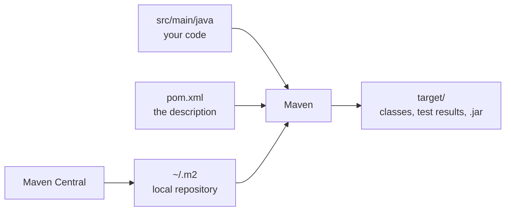
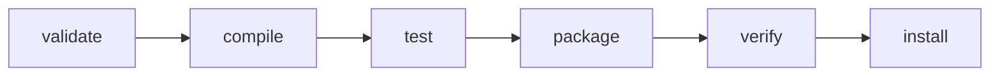

## Learning goals
{: #learning-goals }

By the end of this chapter, you should be able to:

- Say what a build tool does that `javac` and a folder of files cannot.
- Read a `pom.xml` and explain every element in it.
- Build, test, and package a Java project with a single command.
- Add a library as a dependency, and explain where it comes from and what a scope means.
- Turn hand-written checks into JUnit tests that the build runs for you.
- Read a failing build and find the test, the line, and the expectation that failed.
- Keep the build identical on every computer with the Maven Wrapper.
- Explain how Gradle differs from Maven, and when you would meet it.

**Starting point:** you can write and run a small Java program () and keep it in Git (). Install a **JDK 21 or newer** and **Maven** before you start; `mvn -v` should print a version.

## Why a build tool
{: #why-build-tools }

So far, compiling has been one command: `javac ExamScores.java`. That works until the first time any of this happens.

- The program grows to thirty files in several folders, and you need to compile them in the right order, into the right output folder.
- You want to use a library somebody else wrote. Now you have to find its `.jar`, download it, put it somewhere, and repeat that for the three libraries it needs itself.
- You write checks for your code and want them to run every time, not when you remember.
- A classmate clones your repository and cannot build it, because their Java is older, or because the `.jar` you used is only on your laptop.

A **build tool** turns all of that into one command. You describe the project — what it is called, which Java version it needs, which libraries it uses — and the tool compiles the sources, runs the tests, and packages the result the same way on every computer.

In Java, two tools dominate: **Maven**, which this course uses, and **Gradle**, which you meet [at the end of this chapter](#gradle). Other languages have their own: npm for JavaScript (), pip for Python, Cargo for Rust. The vocabulary is nearly identical, so learning one teaches you most of the others.



## Convention over configuration
{: #maven-conventions }

Maven's central idea is that projects should look alike. If you put your files where Maven expects them, you configure almost nothing:

```text
exam-scores
├── pom.xml                                  the project description
├── src
│   ├── main
│   │   └── java                             code that ships
│   │       └── ExamScores.java
│   └── test
│       └── java                             code that checks it
│           └── ExamScoresTest.java
└── target                                   everything Maven generates
```

Two things follow from that picture. Test code lives beside the main code but in its own tree, so tests can see the classes they test without being shipped with them. And everything generated goes into `target/`, which is why that folder is ignored by Git () and why deleting it never loses anything.

This course keeps classes in the default package to stay close to ; real projects use packages such as `ge.edu.sangu.examscores`, mirrored as folders under `src/main/java`. Packages arrive properly in .

## The project file
{: #pom }

`pom.xml` — the Project Object Model — is the one file that describes the project. Download [pom.xml]({{ '/examples/week-03/exam-scores/pom.xml' | relative_url }}):





It is long for what it says, and that is Maven's reputation in one file. Read it in four parts.

**Coordinates.** `groupId`, `artifactId`, and `version` are the project's name in the Java world, usually written `ge.edu.sangu:exam-scores:1.0.0`. The group is normally a domain name backwards; the version follows [semantic versioning]( https://semver.org/), which you met with Conventional Commits in .

**Properties.** `maven.compiler.release` tells the compiler which Java version to target — the same `--release 21` you would pass to `javac`. Setting the encoding explicitly keeps text identical on computers with different system defaults, which is the same class of problem as line endings in .

**Dependencies.** One entry here replaces finding, downloading, and managing a `.jar` by hand. More in [Dependencies](#dependencies).

**Plugins.** Maven does nothing itself; plugins do the work, and each has a version. If you do not pin them, the versions come from whichever Maven is installed, so two people can get different results from the same source. Pinning the compiler and test plugins is two blocks of XML and removes a whole category of "works on my machine".

## One command to build
{: #first-build }

From the folder with `pom.xml`:

```shell
mvn test
```

The first run downloads whatever is missing, which takes a minute; later runs are fast. The end of the output is what you read:

```text
[INFO] --- maven-compiler-plugin:3.13.0:compile (default-compile) @ exam-scores ---
[INFO] Compiling 1 source file with javac [debug release 21] to target\classes
...
[INFO] --- maven-surefire-plugin:3.5.2:test (default-test) @ exam-scores ---
[INFO] -------------------------------------------------------
[INFO]  T E S T S
[INFO] -------------------------------------------------------
[INFO] Running ExamScoresTest
[INFO] Tests run: 5, Failures: 0, Errors: 0, Skipped: 0, Time elapsed: 0.069 s -- in ExamScoresTest
[INFO]
[INFO] Results:
[INFO]
[INFO] Tests run: 5, Failures: 0, Errors: 0, Skipped: 0
[INFO]
[INFO] BUILD SUCCESS
```

`BUILD SUCCESS` means the sources compiled, the tests compiled, and every test passed. Nothing else needs reading.

Package the result:

```shell
mvn package
```

```text
[INFO] --- maven-jar-plugin:2.4:jar (default-jar) @ exam-scores ---
[INFO] Building jar: ...\exam-scores\target\exam-scores-1.0.0.jar
[INFO] BUILD SUCCESS
```

A `.jar` is a zip file of compiled classes with a little metadata. Run the program out of it:

```shell
java -cp target/exam-scores-1.0.0.jar ExamScores
```

```text
Passing scores: 3
```

## The lifecycle
{: #lifecycle }

Maven commands are not arbitrary. A build moves through a fixed sequence of **phases**, and naming one runs it and everything before it:



| Phase | What happens | You type it when |
| --- | --- | --- |
| `compile` | main sources are compiled into `target/classes` | you only want to know whether it builds |
| `test` | test sources are compiled and run | every few minutes, while working |
| `package` | the `.jar` is built in `target/` | you want an artifact to hand over |
| `verify` | additional checks run on the package | a pipeline usually does this () |
| `install` | the artifact is copied into your local repository | another project of yours depends on it |

So `mvn package` also compiles and tests: a packaged artifact that failed its tests would be a lie. `clean` belongs to a separate lifecycle and deletes `target/`, which is why `mvn clean package` is the usual command when something looks stale.

## Dependencies
{: #dependencies }

A dependency is a library named by the same three coordinates your own project has. Maven downloads it from **Maven Central**, the public repository for Java artifacts, and keeps a copy in `~/.m2/repository` on your computer — `C:\Users\you\.m2\repository` on Windows. The second project that needs it uses the cached copy, offline.

Dependencies bring their own dependencies, which Maven resolves for you. Ask what you actually have:

```shell
mvn dependency:tree
```

```text
[INFO] ge.edu.sangu:exam-scores:jar:1.0.0
[INFO] \- org.junit.jupiter:junit-jupiter:jar:5.11.4:test
[INFO]    +- org.junit.jupiter:junit-jupiter-api:jar:5.11.4:test
[INFO]    |  +- org.opentest4j:opentest4j:jar:1.3.0:test
[INFO]    |  +- org.junit.platform:junit-platform-commons:jar:1.11.4:test
[INFO]    |  \- org.apiguardian:apiguardian-api:jar:1.1.2:test
[INFO]    +- org.junit.jupiter:junit-jupiter-params:jar:5.11.4:test
[INFO]    \- org.junit.jupiter:junit-jupiter-engine:jar:5.11.4:test
[INFO]       \- org.junit.platform:junit-platform-engine:jar:1.11.4:test
```

One line in the POM brought eight jars. That is the convenience and the risk together: each of those is code you now run and ship ( on reuse and licences, and  on what else arrives with it).

The word after the version is the **scope**, which says when a dependency is needed:

| Scope | Available in | Typical use |
| --- | --- | --- |
| `compile` | main code, tests, and at run time | a library the program needs, the default |
| `test` | test code only | JUnit, test helpers |
| `provided` | compiling only | something the server supplies at run time |
| `runtime` | running only | a database driver, loaded by name |

Test-scoped dependencies never reach the artifact, so JUnit does not travel with your program.

Two habits keep this manageable. Write exact versions rather than ranges, so a build today and a build next month produce the same thing. And when two libraries want different versions of the same thing, Maven picks the one nearest the root of the tree — `mvn dependency:tree` is how you find out which, before you spend an afternoon wondering.

## The first dependency: JUnit
{: #junit }

In , the checks were a program that printed PASS or FAIL, and a human read the output. That works for five cases and stops working for fifty. **JUnit** is the standard Java library for writing checks as methods, and Maven runs them as part of the build.

Adding it is four lines of POM, with scope `test`:

```xml
<dependency>
  <groupId>org.junit.jupiter</groupId>
  <artifactId>junit-jupiter</artifactId>
  <version>5.11.4</version>
  <scope>test</scope>
</dependency>
```

A test is an ordinary method with an annotation. Download [ExamScoresTest.java]({{ '/examples/week-03/exam-scores/src/test/java/ExamScoresTest.java' | relative_url }}):





Four things are worth naming:

- `@Test` marks a method the build should run. Maven's test plugin finds classes whose names end in `Test`, so `ExamScoresTest` is found and `TestHelper` is not.
- **Assertions** state what must be true: `assertTrue`, `assertFalse`, `assertEquals(expected, actual)`. If the statement is false, the test fails and the build fails with it.
- `@DisplayName` gives the test a sentence, which is what you read in the report. The method name should still say something; `test1` helps nobody.
- Each test checks **one case**, and the cases are the rows of the expected-results table from : below the boundary, exactly on it, above it, a whole group, an empty group.

Deliberate test design — how to choose cases, what to do about things that are hard to test — is . For now, copy your table into tests.

## When a test fails
{: #when-a-test-fails }

Change the rule in `ExamScores` from `score >= PASS_MARK` to `score > PASS_MARK`, the mistake from , and run `mvn test` again:

```text
[ERROR] Tests run: 5, Failures: 2, Errors: 0, Skipped: 0, Time elapsed: 0.057 s <<< FAILURE! -- in ExamScoresTest
[ERROR] ExamScoresTest.exactlyThePassMark -- Time elapsed: 0.006 s <<< FAILURE!
org.opentest4j.AssertionFailedError: expected: <true> but was: <false>
	at ExamScoresTest.exactlyThePassMark(ExamScoresTest.java:20)
...
[ERROR] Failures:
[ERROR]   ExamScoresTest.countsPassingScores:32 expected: <3> but was: <2>
[ERROR]   ExamScoresTest.exactlyThePassMark:20 expected: <true> but was: <false>
[ERROR] Tests run: 5, Failures: 2, Errors: 0, Skipped: 0
[INFO] BUILD FAILURE
```

Read the last block first: it names the test, the line, what was expected, and what happened. One wrong character produced two failures — the boundary test, and the count that depends on it. That is a working safety net: the same change in  needed a human to notice a wrong number in printed output.

The long stack trace above it is mostly JUnit's own frames; the line that matters is the one naming your test. Full reports are written to `target/surefire-reports/` if you prefer to read them there.

`BUILD FAILURE` is also the mechanism behind everything in later weeks: a build that fails stops a pull request from being merged () and stops a broken version from being released ().

## The Maven Wrapper
{: #wrapper }

"Works on my machine" has one more cause: the Maven installed on your machine. The **wrapper** fixes the version in the project itself.

```shell
mvn -N wrapper:wrapper
```

That writes `mvnw`, `mvnw.cmd`, and `.mvn/wrapper/maven-wrapper.properties`. From then on, everyone uses the wrapper instead of their own installation:

```shell
./mvnw test          # macOS, Linux, Git Bash
mvnw.cmd test        # Windows command prompt
```

The first run downloads the Maven version named in the properties file and caches it; nobody has to install anything. Add `-Dmaven=3.9.9` to pick a version. Commit all three files — they are small text files, and they are the reason a classmate can build your project today and in two years.

## What to commit
{: #repository-hygiene }

With a build tool, the rule from  gets concrete:

| Commit | Ignore |
| --- | --- |
| `pom.xml` | `target/` |
| `src/main/java`, `src/test/java` | `*.class` |
| `mvnw`, `mvnw.cmd`, `.mvn/wrapper/` | `.idea/`, `.vscode/` |
| the `README.md` that says `./mvnw test` | downloaded `.jar` files |

So a `.gitignore` for a Maven project is short:

```text
target/
.idea/
*.class
```

Never commit the libraries themselves. The POM names them, and anyone who clones the project gets exactly the same ones.

## Gradle, briefly
{: #gradle }

Gradle is the other build tool you will meet, and it is the default for Android. The concepts are the same — coordinates, repositories, scopes, a wrapper — and the file is a program rather than a document:

```kotlin
plugins {
    java
}

group = "ge.edu.sangu"
version = "1.0.0"

java {
    toolchain {
        languageVersion = JavaLanguageVersion.of(21)
    }
}

repositories {
    mavenCentral()
}

dependencies {
    testImplementation("org.junit.jupiter:junit-jupiter:5.11.4")
}

tasks.test {
    useJUnitPlatform()
}
```

| | Maven | Gradle |
| --- | --- | --- |
| Build file | XML, declarative | Kotlin or Groovy, a program |
| Model | fixed lifecycle of phases | a graph of tasks you can extend |
| Speed | simple and predictable | faster on large projects: incremental builds, caching, a daemon |
| Scopes | `compile`, `test`, … | `implementation`, `testImplementation`, … |
| Where you meet it | most Java back ends, libraries | Android, many newer projects |

The course builds with Maven so that one workflow is learned thoroughly, and because its rigidity is useful while you are learning what a build *is*. Reading a Gradle file is a skill you now have: it names the same things in a different syntax.

## When the build fails
{: #troubleshooting }

| Message | Usual cause |
| --- | --- |
| `'mvn' is not recognized` | Maven is not installed or not on the `PATH`; use `./mvnw` if the project has a wrapper. |
| `invalid target release: 21` | Your JDK is older than the `maven.compiler.release` in the POM. Check `java -version`. |
| `Could not resolve dependencies` | A typo in the coordinates, a version that does not exist, or no network on the first build. |
| `No tests were executed` | The class name does not end in `Test`, or the test plugin is too old for JUnit 5 — pin `maven-surefire-plugin`. |
| `NoClassDefFoundError` when running the jar | The jar holds your classes, not your dependencies. See the second exercise. |
| Strange results that survive edits | Something stale in `target/`: `mvn clean package`. |

When a message is unfamiliar, read the first `[ERROR]` line, not the last: Maven prints the cause first and the consequences after.

## Check your understanding
{: #check-understanding }

<details markdown="1">
<summary>What does `mvn test` do that `javac` and `java` do not?</summary>

It resolves and downloads the libraries the project declares, compiles the main sources and the test sources against them, runs every test class, and fails with a non-zero exit code if any test fails. Each of those is a step you would otherwise do by hand, in the right order, every time.

</details>

<details markdown="1">
<summary>Why does the POM pin the versions of the compiler and test plugins?</summary>

Because otherwise the versions come from whichever Maven each person installed, and the same sources can behave differently on two computers. Pinning them makes the build a property of the project rather than of the laptop.

</details>

<details markdown="1">
<summary>What does scope `test` mean, and why is JUnit in it?</summary>

The dependency is on the classpath when compiling and running tests, and nowhere else. JUnit is only needed to check the program, so it must not be shipped with it or required to run it.

</details>

<details markdown="1">
<summary>One line in the POM, eight jars in the dependency tree. Is that a problem?</summary>

It is a trade-off. You get working, tested code you did not write, and you take on code you did not read: its licence, its defects, and its own dependencies. `mvn dependency:tree` shows what you actually have, which is the first step of taking that seriously.

</details>

<details markdown="1">
<summary>A classmate's build says "No tests were executed" although the test file exists. What do you check?</summary>

The class name — the test plugin only runs classes matching `*Test`, `Test*`, or `*Tests` — and the plugin version, because versions older than 2.22 cannot run JUnit 5 at all. Both are visible in the POM.

</details>

<details markdown="1">
<summary>Why commit `mvnw` and `.mvn/wrapper/` but not `target/`?</summary>

The wrapper is a source: a few small text files that let anyone build the project with the right Maven. `target/` is produced from the sources, changes on every build, and can be recreated at any time.

</details>

## Your turn
{: #your-turn }

### Build the example and break it

1. Download the project files into `exam-scores/pom.xml`, `exam-scores/src/main/java/ExamScores.java`, and `exam-scores/src/test/java/ExamScoresTest.java`, keeping that layout.
2. Run `mvn test`, then `mvn package`, then run the program from the jar.
3. Change `>=` to `>` in `isPassing` and run `mvn test` again. Which tests fail, and why those?
4. Put the rule back, and add one test of your own: a score of 0, or a group where every score passes.

<details markdown="1">
<summary>What you should see</summary>

A clean build ends in five passing tests and `BUILD SUCCESS`. After the change, two tests fail: `exactlyThePassMark`, because 50 is no longer a pass, and `countsPassingScores`, because the group then contains two passes instead of three. The boundary case is doing exactly the job it was written for in  — and now nobody has to read output by eye to notice.

</details>

### Add a dependency

1. Add [Apache Commons Lang](https://commons.apache.org/proper/commons-lang/) to the POM, with no scope so that it is available at run time:

   ```xml
   <dependency>
     <groupId>org.apache.commons</groupId>
     <artifactId>commons-lang3</artifactId>
     <version>3.17.0</version>
   </dependency>
   ```

2. Use it in `main`, for example `System.out.println(StringUtils.center(" Results ", 30, "="));`, and run `mvn test`.
3. Run `mvn dependency:tree` and find the new entry.
4. Now run the program from the jar again, the way you did in the first exercise. Explain what happens.

<details markdown="1">
<summary>Why the jar stops working, and what it teaches</summary>

`mvn test` passes, but running the jar fails:

```text
Exception in thread "main" java.lang.NoClassDefFoundError: org/apache/commons/lang3/StringUtils
```

The jar contains your classes and nothing else, so the library has to be on the classpath too. Maven can write the classpath out for you:

```shell
mvn dependency:build-classpath -Dmdep.outputFile=cp.txt
```

Then run the program with both the jar and that classpath — separated by `;` on Windows and `:` elsewhere:

```text
========== Results ===========
Passing scores: 3
```

A program that is genuinely easy to hand over needs more than a plain jar: a self-contained artifact, or a container that carries the dependencies with it (). This is one of the reasons delivery gets its own week.

</details>

### Make it repeatable, and put it in Git

1. Add the wrapper with `mvn -N wrapper:wrapper`, and build once with `./mvnw test` to see it fetch its own Maven.
2. Make the project a Git repository () with a `.gitignore` that ignores `target/`.
3. Commit the sources, the POM, and the wrapper files, each with a message that says what it is for.
4. Write a `README.md` whose "Run it" section is two lines: `./mvnw test` and `./mvnw package`.
5. Push it to GitHub, and ask a classmate to clone it and build. If they cannot, the README is the bug.

<details markdown="1">
<summary>What `git status` should show after the wrapper</summary>

```text
?? .mvn/
?? mvnw
?? mvnw.cmd
```

All three are committed. `target/` does not appear at all, because `.gitignore` covers it — if it does appear, the file is in the wrong folder or has the wrong name.

</details>

## Summary and key terms
{: #summary }

- A build tool turns "compile, fetch libraries, run the checks, package it" into one command that behaves the same everywhere.
- Maven expects a standard layout, and in return needs almost no configuration: sources in `src/main/java`, tests in `src/test/java`, everything generated in `target/`.
- The POM names the project with coordinates, sets the Java version, declares dependencies, and pins the plugins that do the work.
- Phases run in a fixed order, and naming one runs everything before it, so `mvn package` cannot skip the tests.
- A dependency is three coordinates; it arrives from Maven Central, is cached in `~/.m2`, brings its own dependencies, and has a scope that says when it is needed.
- JUnit turns the expected-results table into methods the build runs, and a failing assertion fails the build with the test, the line, and the two values.
- The wrapper pins the Maven version in the project, so a clone builds the same way on any computer.
- Gradle names the same concepts in a programming language instead of XML.

| English | ქართული |
| --- | --- |
| Build tool | აგების ხელსაწყო |
| Dependency | დამოკიდებულება |
| Library | ბიბლიოთეკა |
| Repository (Maven) | არტეფაქტების საცავი |
| Build lifecycle | აგების სასიცოცხლო ციკლი |
| Packaging | პაკეტირება |
| Unit test | ერთეულოვანი ტესტი |
| Test scope | ტესტის სკოუპი (scope) |
| Build failure | აგების შეცდომა |

## Further reading
{: #further-reading }

- [Maven in Five Minutes](https://maven.apache.org/guides/getting-started/maven-in-five-minutes.html) and the [POM reference](https://maven.apache.org/pom.html) — the official short and long versions.
- [JUnit 5 User Guide](https://junit.org/junit5/docs/current/user-guide/) — annotations, assertions, and everything that comes later in .
- [Maven Central](https://central.sonatype.com/) — where coordinates come from; search before you invent a version number.
- [Introduction to the build lifecycle](https://maven.apache.org/guides/introduction/introduction-to-the-lifecycle.html) — phases, goals, and how plugins bind to them.
- [Gradle user manual](https://docs.gradle.org/current/userguide/userguide.html) — if you meet Gradle in a project or on Android.
