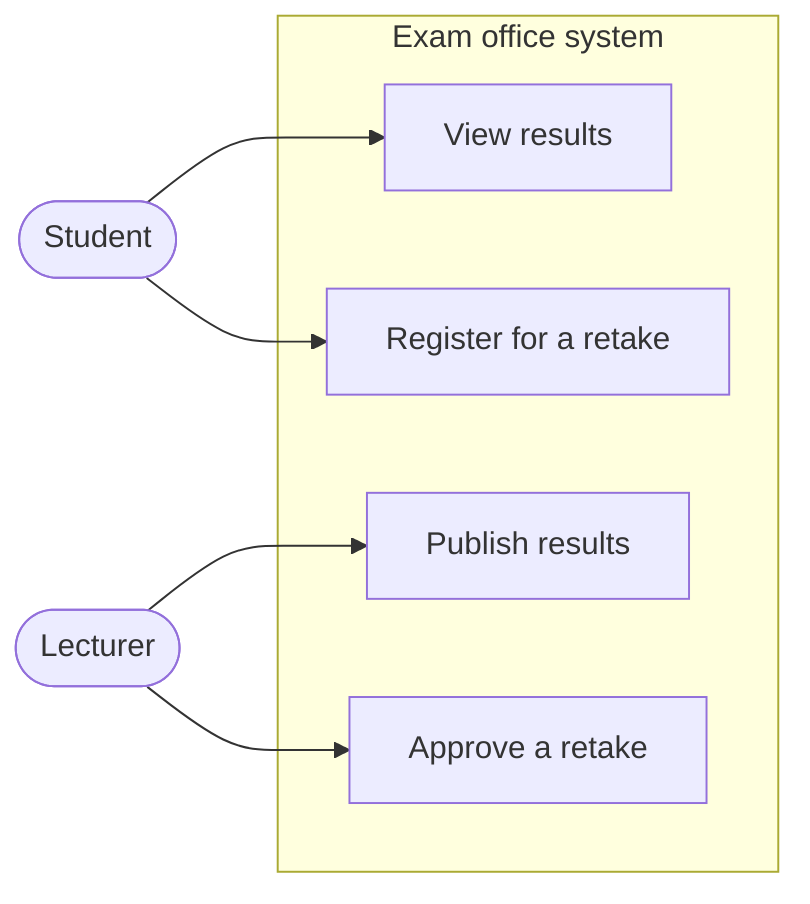
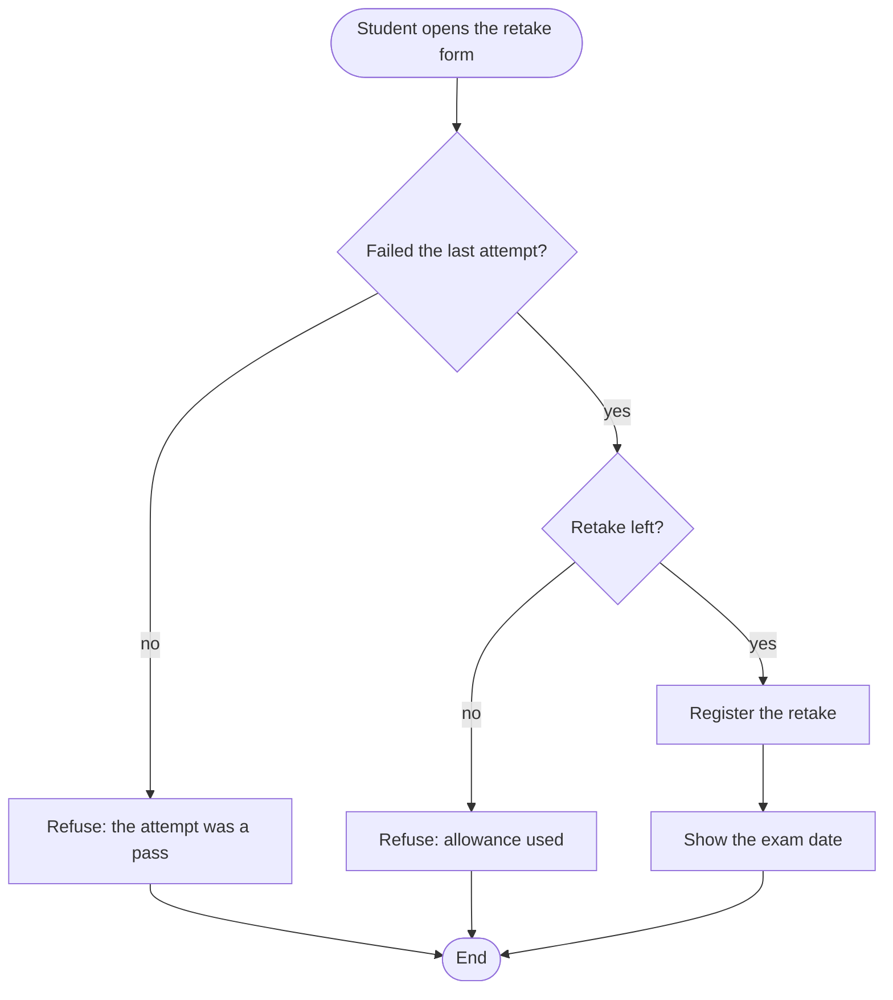
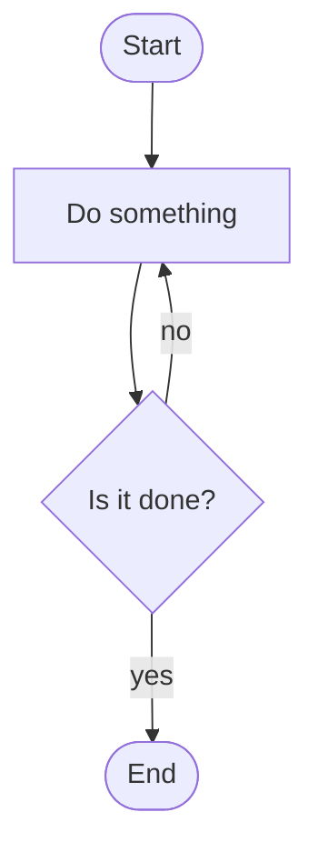
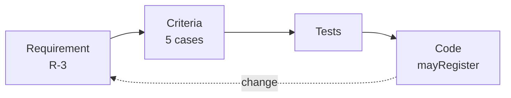

## Learning goals
{: #learning-goals }

By the end of this chapter, you should be able to:

- Name the stakeholders of a small system and say what each one wants from it.
- Tell a functional requirement from a quality requirement, and both from a constraint.
- Rewrite a vague request as a requirement that someone can check.
- Write acceptance criteria that say exactly when a requirement is met.
- Express a rule as a contract: preconditions, postcondition, and what happens when the contract is broken.
- Read and sketch a UML use case diagram, and write the use case description that matters more than the picture.
- Draw a workflow as a Mermaid flowchart, and say honestly how it differs from a UML activity diagram.
- Follow one requirement through criteria, tests, and code.

**Starting point:** you can write a small Java program (), keep it in Git (), and build and test it with Maven (). Nothing new is installed this week: diagrams are text, and GitHub draws them.

## Why requirements come first
{: #why-requirements }

 separated two questions. Verification asks whether the program follows its rules; validation asks whether those rules solve the real problem. A program can pass the first and fail the second, and when that happens, every hour spent writing, reviewing, and testing it was spent on the wrong thing.

Requirements work is how you fail less often. It is not paperwork for its own sake, and it is not a phase that ends: it is the habit of writing down what the software must do, in words precise enough that someone else can check the result.

The cost argument is simple. A misunderstanding caught in a conversation costs a conversation. The same misunderstanding caught after the code is written costs the code as well. Caught after release, it costs the code, the data people entered, the trust they had, and the time to repair all three.

## Who asks, and what for
{: #stakeholders }

A **stakeholder** is anyone affected by the system. For a university exam office, that is at least four groups, and they want different things:

| Stakeholder | Wants | Cares most about |
| --- | --- | --- |
| Student | to see results and register for a retake | clarity, fairness, speed |
| Lecturer | to publish results without repeating work | correctness, little administration |
| Exam office | rules applied consistently | an audit trail, no exceptions by accident |
| Whoever maintains it | to change a rule next year without fear | readable code, tests, documentation |

Two of those four never use the system directly, and the last one may be you in six months. A requirement that satisfies one group at the cost of another is not finished; you have found a decision that someone with authority has to make.

How do you learn what they want? Ask, and then check what you heard. Interviews bring opinions, watching people work brings reality — the exam office's "we always do X" often has three exceptions nobody mentions — and existing documents bring the rules the institution already has. Start with the problem, not the feature: "students miss retake deadlines" is a problem, and "add a notification" is only one answer to it.

## Two kinds of requirement
{: #kinds-of-requirements }

**Functional requirements** say what the system does: "A student who failed an exam may register for one retake." They are behaviour you can demonstrate.

**Quality requirements**, often called non-functional, say how well it does it: how fast, how safe, how usable, how maintainable. They use the vocabulary from : reliability, performance, security, usability, maintainability. A quality requirement is only useful with a number and a condition attached:

| Weak | Usable |
| --- | --- |
| The system must be fast. | Results for one group appear within 2 seconds for 95 of 100 requests, with 200 students enrolled. |
| The system must be secure. | Only the lecturer of a course and the exam office may change a result; every change records who made it and when. |
| The system must be easy to use. | A student who has never used it can find their result in under a minute without help. |

**Constraints** are decisions already made for you: the language, the database the university runs, a legal rule about keeping personal data, a deadline. Write them down too, so nobody wastes a week designing around a choice that was never open.

## What makes a requirement usable
{: #good-requirements }

A usable requirement is **unambiguous**, **verifiable**, about **one** thing, **feasible**, **necessary**, and free of **solution**. The last one surprises people: "add a dropdown of courses" is a design decision wearing a requirement's clothes. Say what the user must achieve and leave the dropdown to design.

Ambiguity is the most common defect, and most of it comes from a short list of words:

| Watch for | Why it hurts | Ask |
| --- | --- | --- |
| fast, easy, user-friendly, robust | nobody can check them | how fast, measured how, for whom? |
| etc., and so on, as appropriate | the list is unfinished | what exactly belongs in the list? |
| should, if possible | nobody knows if it is required | must it be in the release, or not? |
| the data is validated | no actor and no rule | validated by what rule, and what happens when it fails? |
| and / or in one sentence | two requirements hiding as one | split them and check each |

A second test is to ask: **how would I know this is done?** If you cannot answer, the requirement is not finished. That answer has a name.

## Where requirements live
{: #writing-requirements }

Three shapes are common, and they are not rivals.

**Shall statements** suit rules and contracts: "The system shall refuse a retake registration when the student has already used one retake." Precise, slightly stiff, easy to number and trace.

**User stories** suit a backlog of work: "As a student, I want to register for a retake online, so that I do not have to visit the exam office." The format keeps the user and the benefit visible; the detail then lives in acceptance criteria. Turning stories into a plan is .

**A requirements document** collects everything the team agreed. A small one has:

1. **Purpose and scope** — what the system is for, and what it will not do.
2. **Stakeholders and users** — who they are, what they need.
3. **Functional requirements** — numbered, so you can refer to them.
4. **Quality requirements** — with numbers and conditions.
5. **Constraints and assumptions** — including what you assume but have not confirmed.
6. **Glossary** — "retake", "attempt", "enrolled": one meaning each, written down.

The glossary earns its place in week one of any project. Half the arguments about requirements are two people using one word for two things.

## Acceptance criteria
{: #acceptance-criteria }

**Acceptance criteria** say exactly when a requirement is met. They are the bridge between a sentence in a document and a check in a program, and the clearest form is **Given / When / Then**:

> **Given** a student who scored 41 and has used no retakes
> **When** they register for a retake
> **Then** the registration is accepted

Take one requirement — *a student may register for a retake if they failed the last attempt and have not used their retake* — and write the cases out:

| Given | When | Then |
| --- | --- | --- |
| score 41, no retakes used | registering | accepted |
| score 49, no retakes used | registering | accepted |
| score 50, no retakes used | registering | refused: it is a pass |
| score 41, one retake used | registering | refused: no retake left |
| score 101 | registering | refused as invalid input |

Those rows are the expected-results table from , written before the code instead of after it, and they become JUnit tests without any further thinking (). Notice the boundary again: 49 and 50 are both there, because that is where a plausible mistake changes the answer.

## Contracts: preconditions and postconditions
{: #contracts }

Requirements describe a system; a **contract** describes one method, in the same spirit. It has three parts:

- A **precondition** is what the caller must guarantee. "The score is between 0 and 100."
- A **postcondition** is what the method promises in return. "Returns true exactly when the student failed and has a retake left."
- An **invariant** is what stays true throughout. "The number of retakes used never decreases."

In Java, the contract lives in the Javadoc comment, and the precondition is enforced with the `throw` you met in . Download [RetakeEligibility.java]({{ '/examples/week-04/RetakeEligibility.java' | relative_url }}):





```shell
javac RetakeEligibility.java
java RetakeEligibility
```





Three decisions in that file are worth copying. The Javadoc says what the method promises, so a caller does not have to read the body. The precondition is checked, and breaking it produces a loud `IllegalArgumentException` rather than a quiet wrong answer. And the message names the value that was wrong, which is what makes a bug report useful ().

Documenting is not the same as checking. Write both when the caller is someone else — another team, a web request, a file — and rely on the document alone only for internal calls you control. Generating browsable documentation from these comments comes in .

## UML: the language, not the tool
{: #uml }

**UML** (Unified Modeling Language) is a standard set of notations for talking about software: what the parts are, how they interact, how something behaves over time. It is a language, not a program and not a method. You can draw it on a whiteboard, in a drawing tool, or — for some of it — as text that a browser renders.

This course uses a handful of UML views, each answering one question, and introduces each where it is needed:

| View | Question | Week |
| --- | --- | --- |
| Use case | Who uses the system, for which goals? | this week |
| Activity | How does a workflow proceed and branch? | this week |
| Class | What types exist, and how are they related? |  |
| State machine | Which lifecycle transitions are allowed? |  |
| Sequence, component | How do parts collaborate to do one job? |  |
| Deployment | Where does it all run? |  |

The rule that keeps models useful: **a model is small, or it is wallpaper**. Draw the part you are arguing about, agree, and keep the diagram next to the code so it can be updated when the code changes.

## Use cases
{: #use-cases }

A **use case** is one goal that one actor achieves with the system: *register for a retake*, not *click the button*. An **actor** is a role — student, lecturer, exam office — or another system, such as the university's payment service. The **system boundary** separates what you are building from everyone who uses it.

The diagram shows scope at a glance: who deals with this system, and roughly what for.



That picture is a **sketch** of a use case diagram, not UML notation: UML draws actors as stick figures and use cases as ovals inside a labelled rectangle. The information is the same, the symbols are not, so do not hand it in as a UML diagram — draw that one in a UML tool or by hand.

The diagram is also the least valuable half. The **use case description** is where the thinking happens:

> **Use case:** Register for a retake
> **Actor:** Student
> **Precondition:** The student is enrolled in the course and the result of the last attempt is published.
> **Main flow:**
> 1. The student opens the retake form for a course.
> 2. The system checks that the last attempt was a fail and that a retake is left.
> 3. The student confirms.
> 4. The system registers the retake and shows the exam date.
>
> **Alternative flows:**
> 2a. The last attempt was a pass → the system refuses and explains why.
> 2b. The retake allowance is used → the system refuses and points to the exam office.
> 3a. The student cancels → nothing is registered.
>
> **Postcondition:** Exactly one retake registration exists for that student and course, or nothing changed.

Every alternative flow in that description is a row in the acceptance criteria, and most bugs in student projects live in the alternative flows nobody wrote down.

## Workflows and activity diagrams
{: #activity-diagrams }

A **UML activity diagram** shows a workflow: the steps, the decisions, the things that happen in parallel. Its main symbols are few:

| Symbol | Means |
| --- | --- |
| Filled circle | where the workflow starts |
| Rounded rectangle | an action |
| Diamond | a decision, with a guard such as `[failed]` on each outgoing arrow |
| Thick bar | a fork into parallel work, or a join back |
| Circle with a ring | where the workflow ends |

Mermaid does not draw UML activity diagrams, but its **flowchart** carries the same shapes of thought — steps, decisions, ends — and it is text that lives in the repository:



Use it for workflows, and say what it is: a flowchart of the retake process. Calling it an activity diagram in a report is the kind of imprecision this chapter is about.

Notice how closely the diagram matches the use case description and the acceptance criteria. Three views of one rule: a picture to discuss, a description to agree on, a table to check against.

## Mermaid in practice
{: #mermaid }

Mermaid turns fenced code blocks into pictures. GitHub renders them in any Markdown file, and so does this website, which is how every diagram in these chapters is drawn.

````markdown

````

The syntax you need this week fits in a paragraph. `flowchart TD` sets the direction, top-down, and `LR` makes it left to right. Node shapes carry meaning: `["text"]` is a step, `{"text"}` a decision, `([text])` a start or end. Arrows are `-->`, with a label written as `-- yes -->`, and `-.->` for a weaker relationship. `subgraph name["Title"] ... end` groups nodes, as in the sketch above. Use `<br/>` to break a long label.

Two habits make diagrams worth keeping. Put them in the repository, in the Markdown that explains the feature, so a diagram and the code it describes change in the same commit and the same review (). And keep them small: if a diagram needs scrolling, split it, because nobody argues productively about forty boxes. Exporting diagrams as images, for slides or a printed report, comes in .

## From requirement to code
{: #traceability }

**Traceability** means you can follow one requirement forward into the work, and follow any line of code back to the reason it exists.



In a student project this needs no tool: a number in the requirement, the same number in the issue (), and a test whose name says which case it covers.

| Requirement | Criterion | Test | Code |
| --- | --- | --- | --- |
| R-3 a failed attempt with a retake left may register | score 41, 0 retakes → accepted | `failedWithARetakeLeft` | `mayRegister` |
| R-3 | score 50, 0 retakes → refused | `passedExactly` | `mayRegister` |
| R-4 input outside 0–100 is refused | score 101 → `IllegalArgumentException` | `refusesAnImpossibleScore` | precondition check |

The dotted arrow back matters as much as the chain. When the university moves the pass mark or allows two retakes, the change starts at the requirement, moves through the criteria, and only then reaches the code — and the tests tell you whether you finished the job.

## Requirement smells
{: #requirement-smells }

 had code smells: surface signs that something deeper is wrong. Requirements have their own, and they are cheaper to fix.

| Smell | Example | Usual fix |
| --- | --- | --- |
| Ambiguity | "the system is fast" | add a number and a condition |
| Solution in disguise | "add a dropdown of courses" | state the goal; let design choose |
| Two in one | "students register and receive an email" | split into two requirements |
| Untestable | "the code is of high quality" | say how it is checked, or drop it |
| Missing actor | "results are published" | who publishes, and who may? |
| Gold plating | a feature nobody asked for | ask which stakeholder wants it |
| Unstated assumption | "students have an account" | write it under assumptions, then confirm it |

## Check your understanding
{: #check-understanding }

<details markdown="1">
<summary>"The system must be user-friendly." Why is that not a requirement, and what would make it one?</summary>

Nobody can check it: two reasonable people will disagree about whether it is met. Make it verifiable by naming who, what task, and what measure: "a student who has not used the system before can find their exam result in under a minute, without help, in a test with five students."

</details>

<details markdown="1">
<summary>What is the difference between a requirement and an acceptance criterion?</summary>

The requirement says what the system must do; the criterion says how you will know it does. One requirement usually has several criteria, one per interesting case, including the boundaries and the refusals.

</details>

<details markdown="1">
<summary>Why write a precondition in the Javadoc if the method also checks it?</summary>

The check protects the program at run time; the document tells the caller what is expected before they write the call. A caller who reads "score between 0 and 100" avoids the exception entirely, and a reviewer can see whether the check and the promise still agree.

</details>

<details markdown="1">
<summary>You drew a Mermaid flowchart of a workflow. May you call it a UML activity diagram?</summary>

No. It shows the same kind of information, but not in UML notation — no initial node, no guards on the arrows in UML's form, no fork bars. Call it a flowchart. If the assignment asks for an activity diagram, draw one properly in a UML tool.

</details>

<details markdown="1">
<summary>Where do the alternative flows of a use case end up in the code?</summary>

In the branches and the refusals: the pass that cannot be retaken, the allowance already used, the invalid input. They are also where most of the tests live, because the main flow is the case everybody remembers and the alternatives are the ones that get forgotten.

</details>

<details markdown="1">
<summary>A stakeholder asks for a feature that another stakeholder would hate. What is your job?</summary>

To make the conflict visible, not to pick a side quietly. Write both needs down, show what each costs the other, and take the decision to whoever has the authority to make it. Silently choosing one is how projects acquire enemies.

</details>

## Your turn
{: #your-turn }

### Sharpen three requests

A lecturer sends you three sentences. Rewrite each as a requirement that can be checked, and give each one at least two acceptance criteria in Given / When / Then form.

1. "The system should be fast."
2. "Students can easily see their results."
3. "The admin manages everything."

<details markdown="1">
<summary>Model answers</summary>

1. **Requirement:** When a lecturer opens a course's result list with up to 200 students, the page shows the results within 2 seconds for 95 of 100 requests on the university network.
   *Given* a course with 200 published results, *when* the lecturer opens the list, *then* it is visible within 2 seconds.
   *Given* the same course and a slow connection of 1 Mbit/s, *when* the lecturer opens the list, *then* it is visible within 5 seconds.

2. **Requirement:** A student can see, for each course they are enrolled in, the result of their last attempt and whether a retake is possible.
   *Given* a student with a published result of 41, *when* they open their results, *then* the score and "retake possible" are shown.
   *Given* a student whose result is not yet published, *when* they open their results, *then* the course is listed as "not published" and no score is shown.

3. The third is not a requirement but a job title. Split it: who is "the admin", and which goals do they have? Each goal becomes a use case — *publish results*, *correct a published result*, *close registration* — and each gets its own criteria. "Manages everything" also hides a security question for : may an administrator change a grade, and is it recorded?

</details>

### Describe and draw a workflow

Pick a small process you know: submitting a lab assignment, borrowing equipment, booking a consultation.

1. Write the use case description: name, actor, precondition, main flow, at least two alternative flows, postcondition.
2. Draw the workflow as a Mermaid flowchart in a Markdown file, with at least one decision.
3. Sketch the use case diagram for the whole system: the actors, the boundary, and three or four use cases.
4. Commit both to a repository and check on GitHub that the diagrams render ().

<details markdown="1">
<summary>What a good answer contains</summary>

Alternative flows that are genuinely alternative — the deadline has passed, the file is the wrong format, the equipment is already lent out — rather than restatements of the main flow. A decision in the flowchart whose arrows are labelled, so a reader knows which way is which. And a note under the diagram saying that it is a flowchart, not a UML activity diagram.

If GitHub shows the Mermaid source instead of a picture, the fence is wrong: it must be ```` ```mermaid ```` exactly, with the closing fence on its own line.

</details>

### Carry one requirement into code

Take `RetakeEligibility.java` and the five acceptance criteria from [this chapter](#acceptance-criteria).

1. Put the file into a Maven project from .
2. Write one JUnit test per criterion, named after the case rather than the method.
3. Add the refusal case with `assertThrows`, and check the message as well as the type.
4. Change the rule — two retakes instead of one — and watch which tests fail. Update the requirement, the criteria, and the code, in that order.

<details markdown="1">
<summary>The tests, and what the exercise is really teaching</summary>

```java
    @Test
    @DisplayName("a score outside 0 to 100 is refused")
    void refusesAnImpossibleScore() {
        IllegalArgumentException refused =
                assertThrows(IllegalArgumentException.class, () -> RetakeEligibility.mayRegister(101, 0));
        assertEquals("Score must be between 0 and 100: 101", refused.getMessage());
    }
```

Four tests of this shape pass in a few hundredths of a second:

```text
[INFO] Running RetakeEligibilityTest
[INFO] Tests run: 4, Failures: 0, Errors: 0, Skipped: 0, Time elapsed: 0.056 s
[INFO] BUILD SUCCESS
```

The order in step 4 is the lesson. Code changed first is code that disagrees with its documentation; the requirement and the criteria are what everyone else reads.

</details>

## Summary and key terms
{: #summary }

- Requirements work is how you avoid building the wrong thing; validation failures are the expensive kind.
- Stakeholders want different things, and some of them never touch the system. Find the conflicts early and take them to whoever decides.
- Functional requirements say what the system does; quality requirements say how well, with a number and a condition; constraints are decisions already made.
- A usable requirement is unambiguous, verifiable, singular, feasible, necessary, and free of design. Ambiguity hides in a small vocabulary of words: fast, easy, etc., should.
- Acceptance criteria in Given / When / Then say when a requirement is met, and they become tests directly.
- A contract states a method's preconditions and postcondition; Java documents it in Javadoc and enforces it by throwing.
- UML is a language; this week uses use cases for scope and activity diagrams for workflow. The use case description carries more than the picture.
- Mermaid flowcharts live in the repository and render on GitHub, but a flowchart is not a UML activity diagram and should not be called one.
- Traceability runs requirement → criteria → tests → code, and changes travel the same way back.

| English | ქართული |
| --- | --- |
| Requirements analysis | მოთხოვნათა ანალიზი |
| Requirements specification | მოთხოვნათა სპეციფიკაცია |
| Functional requirement | ფუნქციური მოთხოვნა |
| Quality requirement | ხარისხის მოთხოვნა |
| Ambiguity | არამკაფიოობა |
| Acceptance criteria | მიღების კრიტერიუმები |
| Precondition | წინაპირობა |
| Postcondition | შემდგომი პირობა |
| Use case | გამოყენების შემთხვევა (use case) |
| UML diagram | UML დიაგრამა |
| Traceability | მიკვლევადობა |

## Further reading
{: #further-reading }

- Karl Wiegers and Joy Beatty, *Software Requirements*, third edition, 2013 — the standard practical book; chapters on elicitation and on writing good requirements.
- Pankaj Jalote, [A Concise Introduction to Software Engineering](https://link.springer.com/book/10.1007/978-3-031-74318-4), chapter 3 — requirements processes and the structure of a specification document.
- [ISO/IEC/IEEE 29148](https://www.iso.org/standard/72089.html) — the standard behind the characteristics of a good requirement, if you ever need to cite one.
- [UML diagrams reference](https://www.uml-diagrams.org/use-case-diagrams.html) — correct notation for use case and activity diagrams.
- [Mermaid flowchart syntax](https://mermaid.js.org/syntax/flowchart.html) and [GitHub's Mermaid support](https://docs.github.com/en/get-started/writing-on-github/working-with-advanced-formatting/creating-diagrams).
- Mike Cohn, *User Stories Applied*, 2004 — where the "as a … I want … so that …" shape comes from, and how it meets planning in .
