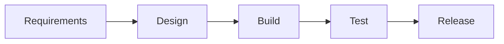
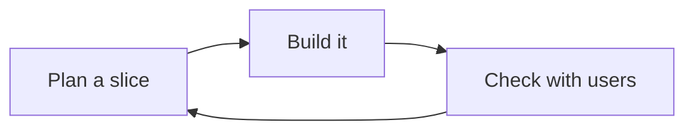
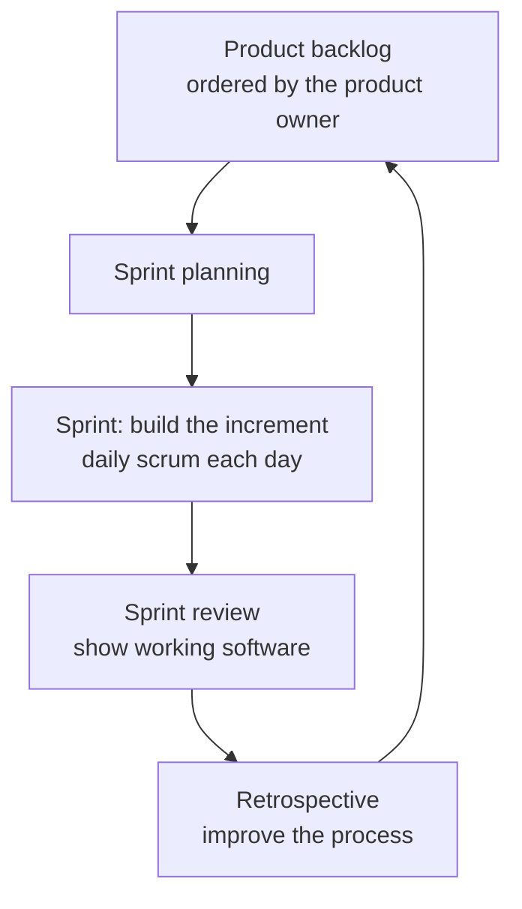
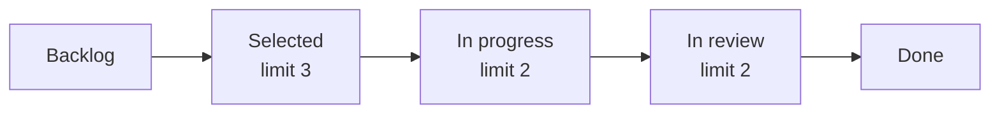

## Learning goals
{: #learning-goals }

By the end of this chapter, you should be able to:

- Explain what a development process is for, and what happens to a team without one.
- Compare code-and-fix, waterfall, prototyping, and iterative development, and say when each is reasonable.
- State what the Agile Manifesto actually says, and what it does not.
- Describe Scrum's roles, events, and artifacts, and Kanban's board and work-in-progress limits.
- Turn requirements into an ordered backlog of small items with a definition of done.
- Estimate work in relative sizes, and explain why an estimate is not a promise.
- Keep a risk register, and tell a mitigation from a contingency.
- Handle a scope change without quietly sacrificing quality.

**Starting point:** you can write requirements and acceptance criteria (), and you use issues and pull requests (). Nothing is installed this week; the tools are a board and two text files.

## What a process is for
{: #why-process }

A **process** is the team's agreement about how work flows: how something becomes a task, who decides the order, what "finished" means, when the team talks, and how a change is handled. Every team has one. The question is whether it was chosen or whether it simply happened.

The process that happens by itself is **code-and-fix**: start coding, fix what people complain about, repeat. For a two-day script that is the correct process — the overhead of anything else would cost more than it saves. It falls apart when the work gets bigger, because nobody can answer three questions: what is left, what will break, and who decides.

Process has a cost, and it is not free of harm. Too much of it slows a small team and produces documents nobody reads; too little leaves people blocked, surprised, and working on the wrong thing. The right amount is the smallest that keeps everyone able to answer those three questions.

## Process models
{: #process-models }

**Waterfall** runs the lifecycle from  once, in order, with a document at each handover.

Its appeal is predictability; its flaw is that validation arrives last. If the requirements were wrong, you find out after everything has been built on them — the expensive failure from . Waterfall still fits work where requirements genuinely cannot change and the cost of a late fix is enormous: a payment terminal's firmware, a contract with a fixed legal scope.

**Prototyping** builds a rough version to answer a question — will users understand this screen, can this library do what we need? A *throwaway* prototype is deleted afterwards; an *evolutionary* one grows into the product, which only works if you are honest about which kind you are building. The usual failure is a throwaway prototype that is shipped because it "already works".

**Iterative and incremental** development runs the same lifecycle in short loops, each producing something that works:

*Incremental* means each loop adds a usable piece; *iterative* means you may also improve what is already there. The point of both is feedback: a wrong assumption costs one loop instead of one project.

| Model | Feedback arrives | Suits | Breaks when |
| --- | --- | --- | --- |
| Code-and-fix | continuously, from complaints | tiny, throwaway work | more than one person, or more than a week |
| Waterfall | at the end | stable, contractual scope | requirements change, or were misunderstood |
| Prototyping | as soon as the question is answered | unknown users, unknown technology | the prototype becomes the product by accident |
| Iterative | every loop | almost everything else | loops grow long enough to hide problems |

Agile methods are iterative development with a particular emphasis on people and change.

## The Agile Manifesto
{: #agile }

In 2001, seventeen practitioners published four value statements, and they are short enough to learn:

| Valued more | Over |
| --- | --- |
| Individuals and interactions | processes and tools |
| Working software | comprehensive documentation |
| Customer collaboration | contract negotiation |
| Responding to change | following a plan |

The sentence that follows the list is the one people forget: the items on the right still have value — the left is simply valued more. That single line rules out most of what gets said in the manifesto's name.

Three misreadings worth naming:

- **"Agile means no documentation."** It means documentation that earns its keep. A README that lets someone run the project () earns it; a 60-page specification nobody opens does not.
- **"Agile means no planning."** Agile teams plan constantly, in small amounts, because they expect the plan to change. What they avoid is one big plan defended against reality.
- **"Agile means no deadlines."** Deadlines are usually fixed. What flexes is scope, which is why the backlog is ordered.

## Scrum
{: #scrum }

**Scrum** is the most used framework built on those values. It fixes a small set of roles, events, and artifacts, and leaves everything else to the team.

**Three accountabilities.** The *product owner* decides what is built and in which order, and is one person, not a committee. The *developers* decide how much fits in a sprint and how to build it. The *scrum master* keeps the process working and removes obstacles — a service role, not a boss.

**Three artifacts.** The *product backlog* is everything that might be built, ordered. The *sprint backlog* is what this sprint will attempt, plus the plan for it. The *increment* is the working software at the end, which must meet the definition of done.

**Five events.** The *sprint* itself, one to four weeks, always the same length. *Sprint planning* chooses the goal and the items. The *daily scrum* is fifteen minutes for the developers to re-plan the day — not a status report to a manager. The *sprint review* shows working software to the people who asked for it and collects feedback. The *retrospective* improves how the team works.

In a student project, a one-week sprint with a fifteen-minute planning session, a two-minute daily message in a group chat, and a half-hour review and retrospective at the end is enough. What matters is that the sprint ends with something that runs.

## Kanban
{: #kanban }

**Kanban** makes the current work visible and limits how much of it exists at once. There are no sprints; work is pulled into the next column when there is room.

The numbers are the point. A **work-in-progress limit** means a column cannot hold more items than the limit, so when review is full, nobody starts something new — they go and review. Teams discover that their real problem was never "we need to work faster" but "eight things were half-finished at once".

Kanban's practices are few: make the work visible, limit work in progress, measure how long items take, write the rules on the board, and improve them together. Two measurements are enough: **cycle time**, how long an item takes from start to done, and **throughput**, how many items finish per week. Both are facts; neither is a guess about the future.

Kanban suits a continuous stream of work — support, maintenance, a course where tasks arrive weekly — while Scrum suits work that benefits from a rhythm and a goal. Many teams run a hybrid, and nobody is checking your badge.

You already have a board. **GitHub Projects** turns the issues from  into a board with columns and limits, and keeps them linked to the pull requests that close them. **Trello** is simpler and not tied to the code. Either is fine; a whiteboard with sticky notes is also fine, as long as everyone can see it.

## From requirements to a backlog
{: #backlog }

A **backlog** is an ordered list of everything that might be built. Ordered, not prioritised into three piles of "high": someone must say what comes first.

Items at the top are small and clear, because they are about to be built. Items further down are rough, because refining something that may never be built is waste. The team spends a little time each week **refining** the top: splitting, clarifying, adding acceptance criteria from .

A worked example — download [backlog.md]({{ '/examples/week-05/backlog.md' | relative_url }}):





Three things in that file are worth copying into your own.

**Each item is a user story with criteria.** The story says who wants it and why; the criteria say when it is done. Together they are enough for someone else to build it.

**Items are small.** A good rule for a student team: nothing in the next iteration takes more than two days. If it does, split it — by rule ("register" before "register with a deadline"), by case ("the happy path" before "the refusals"), or by interface ("works from a method" before "works from a screen").

**The definition of done is written once, for everything.** It is the team's standard, and it is where the previous four weeks show up: the acceptance criteria pass, tests run in the build (), the change was reviewed and merged (), and the documentation matches. "Done" on the board must mean the same thing every time, or the board lies.

## Estimation
{: #estimation }

 showed the cone of uncertainty: early estimates are wrong by several times, in both directions. Estimation does not fix that. It gives you a shared expectation, and an early warning when something is bigger than anyone thought.

**Relative sizes beat hours.** People are poor at predicting hours and much better at comparing: "this is about twice that". Teams size items in **story points** on a scale that grows (1, 2, 3, 5, 8, 13), where the gaps are a reminder that big numbers are guesses. An 8 usually means "we do not understand this yet"; split it.

**Estimate together.** In *planning poker*, everyone picks a size privately, then all reveal at once. The disagreements are the value: when one person says 2 and another says 13, they have understood the item differently, and the discussion finds the thing nobody had noticed.

**Velocity is measured, not promised.** After a few iterations, a team knows it finishes roughly N points per week. That number forecasts; it does not motivate. The moment velocity becomes a target, items quietly grow bigger and the number means nothing.

Three habits keep estimation honest:

- Estimate the work, not the person. "Two days for me, five for you" is a staffing problem, not an estimate.
- Give a range, or a size, not a single number: "3 points, which has been two to four days for us".
- When an estimate turns out wrong, say so the same day. An estimate is a prediction; discovering it was wrong is information, not failure.

## Planning an iteration
{: #planning }

An iteration plan answers two questions: what is the goal, and what will we pull in to reach it.

Capacity is honest arithmetic. Two students with ten hours each do not have twenty hours of building: lectures, review, the lab, and the things that always go wrong take their share. Plan for about two thirds, and let the measured velocity correct you.

Pull items from the top of the backlog until the capacity is used, and stop. Half an item is worth nothing, so a plan with one more item "if there is time" is better than a plan that assumes everything goes well. Write the **iteration goal** as a sentence someone outside the team would understand: "a student can see a result and register for a retake".

## Tracking what is happening
{: #tracking }

The board is the status report. An item is in exactly one column, and moving it is the update; a separate written report is duplication that goes stale.

Three signals are worth watching:

- **Items finished**, not items started. "80 per cent done" means nothing, because the last 20 per cent contains the integration, the review, and the bugs. An item is done or it is not.
- **Age of the oldest item in progress.** Something that has been in progress for four days is stuck, whether or not anyone has said so.
- **Items blocked.** A blocked item is a question for the team, today, not an excuse at the end of the week.

A burndown chart adds nothing a board plus those three signals do not already say. If you draw one, draw it to start a conversation, not to prove you are on schedule.

## Risk
{: #risk }

A **risk** is something that has not gone wrong yet. Once it has, it is a problem, and it belongs in the issue tracker. The register is for the ones you can still cheaply prevent.

Download [risk-register.md]({{ '/examples/week-05/risk-register.md' | relative_url }}):





Each risk has a probability and an impact, each rated low to high, and their product orders the list. Then two different answers, which beginners usually confuse:

- A **mitigation** reduces the chance or the impact *now*: pair on the database work so that two people know it.
- A **contingency** is what you will do *if it happens anyway*: a one-hour handover, prepared in advance.

The five risks in that register are the ones student projects actually hit: an unanswered decision, one person holding all the knowledge, integration left until the end, real data used for testing, and a deadline that moves. Review the list weekly in the retrospective; a register written once and never reopened is decoration.

## When the scope changes
{: #change }

It will.  said change is normal and its cost depends on how many places know about the thing that changed;  said requirements evolve as people learn. Process is how a team absorbs that without quietly breaking something.

When a new request arrives, answer three questions in the open:

1. **What does it displace?** With a fixed deadline and team, something leaves the iteration. Name it.
2. **What does it touch?** Requirement, criteria, tests, code, documentation — the chain from .
3. **Is it the same size as it looks?** "Just add a button" has a rule behind it, and the rule has refusals.

Then record the decision where the work lives: a comment on the issue, a line in the backlog, a note in the review. Silent acceptance is the dangerous answer, because the cost appears later as missed quality rather than as a conversation.

Two names for the same failure: **scope creep** is accepting changes without removing anything, and **gold plating** is adding work nobody asked for because it seemed nice. Both end the same way, with a late project full of half-finished ideas.

## Working as a team
{: #team }

Most student-project failures are not technical. They are four people assuming someone else is doing something.

Agree these once, in writing, in the repository:

- **Who decides.** One person breaks ties on scope; one person breaks ties on design. Rotating is fine; ambiguity is not.
- **How work is taken.** From the top of the board, not from "whatever I feel like". One item at a time per person.
- **What done means.** The definition of done, in the repository, applied to everything.
- **How you communicate.** Where questions go, how fast an answer is expected, and what happens when someone cannot work this week. Saying "I am stuck" on Tuesday is a contribution; saying it on Sunday is an incident.
- **Shared ownership.** Anyone may change any file, and every change is reviewed (). A module that only one person may touch becomes a single point of failure the week they are ill.

## Retrospectives
{: #retrospectives }

At the end of each iteration, the team spends half an hour on three questions: what went well, what did not, and what we will change. The last one is the only one that matters, so it has rules: **one change**, **specific**, and **owned by someone**.

"Communicate better" is not a change. "Post a two-line status in the group chat before 10:00, and Luka reminds us on Monday" is. Next retrospective starts by asking whether it happened.

Keep it blameless. The question is what in the way we work made this likely, not who did it. A team that answers honestly improves; a team that looks for someone to blame learns to hide problems, which is how a late project becomes a surprise.

## Choosing a process for your project
{: #choose }

For a semester project of two to four people, this is enough:

1. A **backlog** in GitHub Issues, ordered, with the top items refined and estimated.
2. A **board** with four columns and a work-in-progress limit of about one item per person.
3. A **one-week iteration** with a goal, ending in something that runs.
4. A **definition of done** in the repository, including review and tests.
5. A **fifteen-minute retrospective** that produces one change.
6. A **risk register** reviewed weekly.

That is roughly an hour of process per week. If a ritual stops earning its hour, drop it and say why in the retrospective — that decision is itself the process working. What you must not drop is the part that produces something running every week, because it is the only honest evidence of progress.

## Check your understanding
{: #check-understanding }

Why does waterfall fail when requirements are uncertain, and when is it still a fair choice?

Because validation happens last: if the requirements were wrong, everything built on them is wrong too, and the discovery comes when changing it is most expensive. It is fair when requirements genuinely cannot move — a fixed legal scope, firmware with a certification process — and when a late change would be catastrophic rather than merely annoying.

"We are agile, so we do not write documentation." What is wrong with that sentence?

The manifesto values working software *over* comprehensive documentation, and says explicitly that the item on the right still has value. The test is whether a document earns its cost: a README that lets a new person run the project does; a specification nobody reads does not.

What is a work-in-progress limit for?

To stop the team starting more than it can finish. When a column is full, the next person helps finish something instead of starting something new. It converts a pile of half-done work into a steady flow of done work, and it makes bottlenecks visible — the full column is the bottleneck.

Your team's velocity was 12, 9, and 14 points. What can you honestly say about next week?

That about 10 to 14 points is likely, and that a plan needing 20 is a plan to disappoint someone. Velocity forecasts a range for the same team doing similar work; it is not a target, not a measure of individual effort, and not comparable with another team's number.

Give a mitigation and a contingency for "the only person who understands the database is ill in the final week".

Mitigation, now: pair on database work and review every change, so a second person can read it. Contingency, if it happens: a prepared one-hour handover, and a decision in advance about which feature is cut if the handover is not enough.

A stakeholder adds a feature mid-iteration and the deadline does not move. What do you do?

Make the trade visible: say what the new item displaces, what it touches across requirements, tests, and documentation, and agree the exchange with whoever owns the scope. Record the decision on the issue. Accepting silently and absorbing it by skipping tests is the one answer that is always wrong.

## Your turn
{: #your-turn }

### Build a backlog you can defend

Take the requirements you wrote in , or the exam office example.

1. Write six to eight items as user stories, each with at least two acceptance criteria.
2. Size them relatively: 1, 2, 3, 5, or 8. Anything you want to call 13, split.
3. Order the list, and write one sentence per item saying why it is above the one below it.
4. Write your team's definition of done, and keep it in the repository.
5. Select an iteration's worth, and write the iteration goal as one sentence.

What a defensible order looks like

Value and risk, not comfort. The item that answers an open question goes early even if it is dull, because it unblocks the rest; the item that is only valuable once three other things exist goes after them; and the feature you most want to write is not automatically first.

In the example backlog, "see my result" comes before "be notified about a result", because the notification is worth nothing until results exist, and "correct a published result" waits because the rule for who may publish has not been decided yet. Both are reasons someone else can check.

### Run one iteration on a board

1. Put the items into GitHub Issues, and create a GitHub Project board with Backlog, Selected, In progress, In review, Done.
2. Set a work-in-progress limit of one item per person for In progress, and write it on the board.
3. Run the iteration for a week. Move items yourself; link each pull request to its issue with `Fixes #n` ().
4. At the end, count what finished, and note the oldest item still in progress and why.
5. Hold a fifteen-minute retrospective and write down one change with an owner.

What the first iteration usually teaches

That items were too big, and that "In review" is where everything piles up. Both show up as the same symptom: things started, nothing finished. The usual first improvements are to split items so each is at most two days, and to agree that reviewing a teammate's pull request comes before starting your own next item.

If the board and reality disagree at the end of the week, the board lost: fix the habit, not the board.

### Write and use a risk register

1. List five risks for your project, each as something that has *not* happened yet.
2. Rate probability and impact from 1 to 3 and order by the product.
3. For the top three, write a mitigation that starts this week and a contingency if it happens anyway, each with an owner.
4. At the next retrospective, review the register: what changed, what happened, what is new.

Two tests for a risk register

Every mitigation names something a person does this week; "be careful" is not a mitigation. And the register changes between reviews — risks that have happened move to the issue tracker, risks that passed are closed, new ones appear. A register identical to last month's was not reviewed.

## Summary and key terms
{: #summary }

- A process is the team's agreement about how work flows. Every team has one; choose the smallest that keeps "what is left, what will break, who decides" answerable.
- Waterfall validates last, prototyping answers one question, and iterative development shortens the feedback loop so a wrong assumption costs one loop.
- The Agile Manifesto values four things more than four others, and says the others still matter. It does not abolish documentation, planning, or deadlines.
- Scrum fixes three accountabilities, three artifacts, and five events around a fixed-length sprint that ends in working software.
- Kanban makes work visible and limits work in progress, so the team finishes things instead of starting them.
- A backlog is ordered; the top is small and refined, the bottom is rough on purpose, and the definition of done is written once for everything.
- Estimate in relative sizes, together, and treat velocity as a measurement rather than a target.
- Risks get a probability, an impact, a mitigation now, and a contingency if they happen; once a risk happens it becomes an issue.
- Scope changes are normal and must be traded openly: what it displaces, what it touches, how big it really is.

| English | ქართული |
| --- | --- |
| Development process | შემუშავების პროცესი |
| Waterfall model | ჩანჩქერის მოდელი |
| Prototype | პროტოტიპი |
| Iterative and incremental development | იტერაციულ-ევოლუციური განვითარება |
| Agile methodology | Agile მეთოდოლოგია |
| Scrum | Scrum |
| Kanban board | Kanban დაფა |
| Backlog | ბექლოგი (backlog) |
| Estimation | შეფასება |
| Risk assessment | რისკების შეფასება |
| Risk management | რისკების მართვა |
| Project monitoring | პროექტის მონიტორინგი |

## Further reading
{: #further-reading }

- [The Agile Manifesto](https://agilemanifesto.org/) and its twelve principles — two short pages, worth reading in the original.
- [The Scrum Guide](https://scrumguides.org/) — the whole framework in thirteen pages, by its authors.
- Pankaj Jalote, [A Concise Introduction to Software Engineering](https://link.springer.com/book/10.1007/978-3-031-74318-4), chapter 2 — process models and project planning, including risk.
- Mike Cohn, *Agile Estimating and Planning*, 2005 — story points, velocity, and planning poker in depth.
- [Atlassian's Kanban guide](https://www.atlassian.com/agile/kanban) — boards, work-in-progress limits, and flow metrics, with examples.
- [GitHub Projects documentation](https://docs.github.com/en/issues/planning-and-tracking-with-projects) — turning the issues from  into a board with views and automation.
