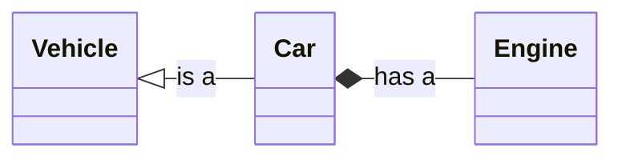
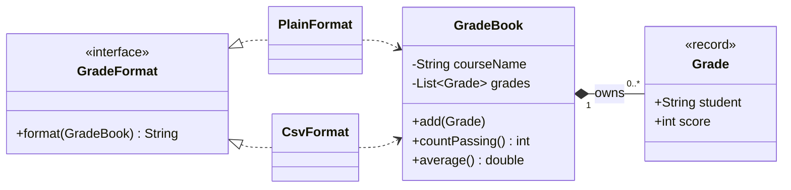
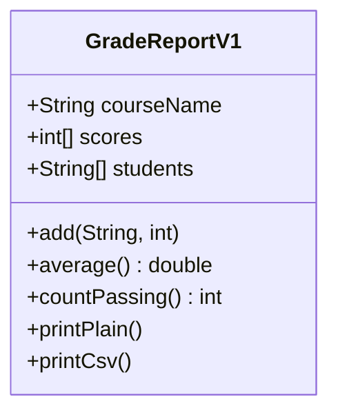

## Learning goals
{: #learning-goals }

By the end of this chapter, you should be able to:

- Give a class one responsibility and say what it is in a sentence.
- Write a class that cannot exist in an invalid state, and explain why that is worth doing.
- Recognise weak cohesion and unnecessary coupling in code you did not write.
- Choose composition instead of inheritance, and say why inheritance was the wrong tool.
- Define an interface, write two implementations, and depend on the interface rather than on either one.
- Apply the five SOLID principles to a small design, and say when each is over-applied.
- Draw a UML class diagram in Mermaid that matches the code it describes.

**Starting point:** you can write Java methods (), build and test with Maven (), and write requirements and contracts (). This week turns those into types.

## Why design, when it already works
{: #why-design }

 ended with a program that worked: methods with good names, no duplication, checks that pass. Design is the next question. Not "does it work?" but **"when the next change arrives, how much of this has to move?"**

Three things make that question concrete, and they are the whole chapter:

- A unit with one **responsibility** changes for one reason.
- A unit that **hides** its data can protect its own rules.
- A unit that depends on a **promise** rather than on another unit's insides can be rebuilt without disturbing its neighbours.

Objects are one way to get all three. A class puts data and the rules about that data in one place, and lets you hand out behaviour while keeping the data to yourself.

## Responsibility
{: #responsibility }

A **responsibility** is a reason to change. The exam office may change how a report looks; it may also change the pass mark. Those are two reasons, so they belong in two places.

The test is a sentence. Say what the class does, out loud, without "and":

- "`GradeBook` keeps the grades of one course and answers questions about them." Good.
- "`GradeReport` holds the grades, works out the averages, prints the plain text, and writes the CSV file." Four responsibilities wearing one name.

This is the **Single Responsibility Principle**, and it applies at every size: a method, a class, a module, a service. It is the same instinct as 's small functions, applied to types.

## Objects in Java, quickly
{: #objects-in-java }

A **class** describes what an object knows and what it can do. An **object** is one instance of it, with its own values.

```java
public class GradeBook {
    private final String courseName;          // what it knows: fields, private
    private final List<Grade> grades = new ArrayList<>();

    public GradeBook(String courseName) {     // how it is created: a constructor
        this.courseName = courseName;
    }

    public int countPassing() { ... }         // what it can do: methods
}
```

Four words you need this week:

- **`private`** means only this class can see the field. **`public`** means anyone can. Default to private.
- **`final`** on a field means it is set once, in the constructor, and never reassigned.
- **`this`** is the object the method was called on; `this.courseName = courseName` assigns the parameter to the field.
- **`static`** belongs to the class rather than to any object. `PASS_MARK` is static because the rule is the same for every book; `grades` is not.

Java 21 adds a short form for data that is just data. A **record** gives you the fields, a constructor, `equals`, `hashCode`, and `toString` in one line:





The block without a parameter list is a *compact constructor*: it runs before the fields are set and is the place to refuse impossible values. A `Grade` with a score of 150 cannot exist, anywhere in the program, ever.

## Encapsulation and invariants
{: #encapsulation }

An **invariant** is something that must always be true of an object: a grade's score is between 0 and 100; a grade book has at most one grade per student; a course name is not blank.

**Encapsulation** is how an object defends its invariants: keep the data private, and let the outside world in only through methods that check. The alternative — public fields, or a getter that hands out the real list — means every caller is responsible for the rules, and one of them will forget.

Two lines in the worked example do this work:

```java
private final List<Grade> grades = new ArrayList<>();

public List<Grade> grades() {
    return List.copyOf(grades);      // a copy, so a caller cannot add behind our back
}
```

Returning the field itself would let any caller do `book.grades().clear()`, and the duplicate check in `add` would be decoration. This is the object-level version of the contracts from : the precondition is checked where the rule lives, and breaking it throws rather than quietly corrupting the data.

## Cohesion
{: #cohesion }

**Cohesion** is how strongly the parts of a unit belong together. High cohesion means every field and method serves the same job.

Weak cohesion is easy to spot once you look for it:

| Smell | Example | What it usually means |
| --- | --- | --- |
| Unrelated fields | a class holding `grades` and `databaseUrl` and `printerName` | three classes in a trench coat |
| Methods that use nothing | a method that touches no field of its class | it belongs somewhere else, or it is static |
| Subsets that never meet | half the methods use fields A and B, the other half use C | split along the line that already exists |
| A name with "and" or "Manager" | `StudentAndCourseManager` | nobody could name one responsibility |

The repair is almost always the same: find the fields that are used together, and move them with their methods into a class whose name says what they are.

## Coupling
{: #coupling }

**Coupling** is how much one unit needs to know about another. Some is necessary — a program of perfectly isolated classes does nothing — but each connection is a path along which change travels.

Coupling is tighter the more a caller knows:

1. **Data.** It calls a method and passes values. Loosest, and what you want.
2. **Structure.** It knows the shape of what comes back and reaches through it: `book.grades().get(0).student().length()`.
3. **Control.** It passes a flag that tells the other unit *how* to behave: `format(book, true)` — the flag argument from .
4. **Internal.** It depends on data another unit owns, or on how it stores it.

A practical rule: **talk to your neighbours, not to strangers**. If a method reaches through two dots to get at something, the thing it needs probably belongs on the object it already has. And prefer depending on an **interface**, because then you depend on what something promises rather than on how it does it.

## Composition over inheritance
{: #composition }

Java gives you two ways to build a type out of another. **Inheritance** says *is a*: `class Manager extends Employee`. **Composition** says *has a*: a `Car` holds an `Engine`.



Inheritance looks economical and is the most over-used feature in the language, because it couples two classes as tightly as the language allows. The subclass depends on the superclass's fields, its methods, and the order in which it calls them; changing the parent quietly changes every child. The classic trap is a type that *looks* like a special case but does not behave like one: a `Square` that extends `Rectangle` breaks the moment someone sets the width and expects the height to stay.

Use inheritance when the subtype can be used *everywhere* the supertype can, without surprises, and when the relationship is genuinely permanent. Otherwise hold the other object and delegate to it:

```java
public class TimedGradeBook {
    private final GradeBook book = new GradeBook("Software Engineering");

    public void add(Grade grade) {
        long start = System.nanoTime();
        book.add(grade);                       // delegate
        System.out.println("add took " + (System.nanoTime() - start) + " ns");
    }
}
```

Composition is longer to write and far easier to change: the wrapper can be removed, replaced, or reused, and `GradeBook` never learns it exists.

## Interfaces
{: #interfaces }

An **interface** is a promise without an implementation: a list of methods that any implementing class must provide.





Any class can implement it:





Interfaces earn their place in three ways:

- **Substitution.** Code written against `GradeFormat` works with every formatter, today's and next year's.
- **Independence.** A new format is a new file. Nothing that already works is edited, so nothing that already works can break.
- **Testing.** A test can supply a tiny fake implementation instead of the real thing — a file writer that records what it was given, say — which is how you test code that would otherwise need a disk or a network ().

The cost is a layer of indirection, so add an interface when you have a reason: two implementations, a boundary you want to test across, or a dependency you expect to replace. One implementation and no plan is just extra reading.

## SOLID, five ideas you will use
{: #solid }

SOLID is five design principles with a memorable acronym. They are guidelines, not laws, and each is a trade.

**S — Single responsibility.** One reason to change. `GradeBook` keeps grades; formatting lives elsewhere. If the exam office changes the report layout, the grade rules are untouched.

**O — Open for extension, closed for modification.** You should be able to add behaviour without editing what works. Adding `CsvFormat` required no change to `GradeBook`, `PlainFormat`, or the interface. The lever that makes this possible is almost always an interface.

**L — Liskov substitution.** Anything implementing a type must behave like it. A `GradeFormat` that returns `null` for an empty book, or throws where the others return text, breaks every caller written against the interface. Inheritance that violates this is the `Square`/`Rectangle` trap.

**I — Interface segregation.** Small interfaces. `GradeFormat` has one method, so a new format implements one method. An interface with `format`, `print`, `save`, and `email` forces every implementation to carry three jobs it does not want.

**D — Dependency inversion.** Depend on abstractions, not on concrete classes. `GradeReport` holds a `GradeFormat`; it never mentions `PlainFormat` except in the one line that chooses it. The choice of implementation moves to the edge of the program, where it can be changed.

A caution that matters as much as the principles. Applied to a 200-line program, all five at once produce a maze of interfaces with one implementation each, and that is worse than the problem they solve. Apply them when you feel the pain they address: the class that changes for three different reasons, the `if` chain that grows with every new case, the test you cannot write.

## Class diagrams
{: #class-diagrams }

A **UML class diagram** shows types and their relationships. Unlike the use case sketch in , this one Mermaid draws properly, so the diagram can live in the repository beside the code.

The notation you need:

| Notation | Meaning |
| --- | --- |
| A box with three parts | the class name, its attributes, its operations |
| `+` `-` | public, private |
| `<<interface>>` | a stereotype: this type is an interface |
| `A <|.. B` | B implements interface A |
| `A <|-- B` | B extends A |
| `A *-- B` | composition: A owns B, and B does not outlive A |
| `A o-- B` | aggregation: A holds B, but B exists independently |
| `A --> B` | association: A has a reference to B |
| `A ..> B` | dependency: A uses B, for example as a parameter |
| `"1"` `"0..*"` | multiplicity, written next to the ends |

The design of this chapter's example, as Mermaid draws it:



Two rules keep diagrams honest. **Draw what exists**, or label it clearly as a proposal; a diagram that disagrees with the code teaches the wrong thing to the next reader. And **draw one view**: the types involved in the decision you are discussing, not every class in the project.

## A worked design
{: #worked-example }

Start where student projects usually start — one class that does everything:

```java
public class GradeReportV1 {
    String courseName;
    int[] scores;
    String[] students;

    void add(String student, int score) { ... }
    double average() { ... }
    int countPassing() { ... }
    void printPlain() { ... }
    void printCsv() { ... }
}
```

It works. It also has four responsibilities, two parallel arrays that must stay in step, public fields anyone can corrupt, and a new `print` method for every future format.



Separate the responsibilities and the design above appears: a `Grade` that cannot be invalid, a `GradeBook` that owns its grades and the pass rule, an interface for output, and two small implementations.

The grade book is the piece worth reading in full. Download [GradeBook.java]({{ '/examples/week-06/GradeBook.java' | relative_url }}):





Notice what it refuses to do. It does not print. It does not know about CSV. It does not hand out its list. It does not accept a second grade for the same student. Everything it does know — the pass mark, the duplicate rule, how an average is computed — is knowledge about grades, and there is exactly one place to change each of them.

The program that uses it chooses an implementation once and then talks only to the interface. Download [GradeReport.java]({{ '/examples/week-06/GradeReport.java' | relative_url }}), with [PlainFormat.java]({{ '/examples/week-06/PlainFormat.java' | relative_url }}) and [CsvFormat.java]({{ '/examples/week-06/CsvFormat.java' | relative_url }}):





```shell
javac *.java
java GradeReport
```





One detail in `PlainFormat` is worth borrowing: it formats numbers with `Locale.ROOT`, so the average prints as `60.3` on every computer. Without it, the same program prints `60,3` in half of Europe, and a test that passes on your laptop fails in the build ().

## When not to design
{: #over-design }

Design costs something, and the costs are easy to miss because they look like virtue.

- **Speculative generality.** An interface, a factory, and a configuration file for a feature nobody has asked for. Build it when the second case arrives — the rule of three from .
- **Indirection without a reason.** Four layers to reach a number. Each hop is a place to look when something is wrong.
- **Classes that are only data.** A class with nothing but getters and setters, while the rules about that data live in some other class, is a record with extra words. Either move the behaviour in, or use a `record` and be honest.
- **Premature class explosion.** Twelve classes for 200 lines. Fewer, well-named units are easier to read than many tiny ones.

The honest sequence is: make it work, make it clear, and give it structure when a second reason to change appears. Design that arrives with the first change request is on time; design that arrives before the requirement is a guess.

## Check your understanding
{: #check-understanding }

<details markdown="1">
<summary>What is wrong with a class called `StudentManager`?</summary>

"Manager" is the name you give something when you cannot say what it does. Ask what changes would force you to edit it: if the answer is "a new report, a new validation rule, and a new database column", it holds three responsibilities and should be three types with honest names.

</details>

<details markdown="1">
<summary>Why does `grades()` return a copy instead of the list itself?</summary>

Because handing out the real list hands out the ability to change it without passing through `add`, and the duplicate-student invariant would then be unenforceable. An object can only defend a rule about data it controls.

</details>

<details markdown="1">
<summary>You need a grade book that logs every addition. Inheritance or composition?</summary>

Composition: hold a `GradeBook` and delegate to it, adding the logging around the call. Extending would tie the logging class to the internals and the call order of `GradeBook` for ever, and would break the day `add` starts calling another public method internally.

</details>

<details markdown="1">
<summary>Adding `CsvFormat` required no edits to existing classes. Which principle is that, and what made it possible?</summary>

Open for extension, closed for modification. What made it possible is the interface: because callers depend on `GradeFormat` rather than on a concrete formatter, a new implementation plugs in without touching code that already works.

</details>

<details markdown="1">
<summary>When is one interface with one implementation still worth it?</summary>

When you need the seam: to swap in a fake for tests, to hide something slow or external behind a boundary, or because a second implementation is already planned. Without one of those, it is a layer of reading for no benefit.

</details>

<details markdown="1">
<summary>A class diagram shows a relationship the code does not have. Which one is wrong?</summary>

The diagram, always — the code is what runs. A diagram's only value is as an accurate summary of the design, so an out-of-date one is worse than none: it is a confident lie. Keep diagrams in the repository and update them in the same pull request as the code.

</details>

## Your turn
{: #your-turn }

### Split a class that does too much

Take `GradeReportV1` from [the worked design](#worked-example), or the most tangled class in your own project.

1. List every reason it would have to change. One line each.
2. Group the fields by which methods use them. The groups are your candidate classes.
3. Extract one class, with private fields and a constructor that refuses invalid values.
4. Move the methods that belong with those fields. Compile after each move.
5. Write down, in one sentence, what each resulting class is responsible for.

<details markdown="1">
<summary>What good groups look like</summary>

In the grade example the fields split cleanly: `students` and `scores` always move together and belong with `add`, `average`, and `countPassing`, while nothing in `printPlain` and `printCsv` touches them except to read. That is the seam: data and its rules on one side, presentation on the other.

If a method uses fields from both groups, it is usually doing two things — split the method before splitting the class.

</details>

### Add a format without touching what works

1. Write a third implementation of `GradeFormat`: Markdown table, JSON, or one line per failing student.
2. Compile and run it from `GradeReport`. Confirm that `git diff` shows no changes to `GradeBook`, `Grade`, or the other formats ().
3. Write a tiny fake implementation that records the book it was given and returns a fixed string, and use it to test the calling code without printing anything.
4. Put the classes into a Maven project () and write JUnit tests for `GradeBook`: the duplicate refusal, the empty-book average, and the pass boundary at 50.

<details markdown="1">
<summary>The boundary cases worth testing, and why the fake matters</summary>

The three tests are the invariants, not the happy path: adding a second grade for the same student throws, `average()` on an empty book throws, and a score of exactly 50 counts as passing — the boundary from  again.

The fake is the point of the interface. Testing `GradeReport` against the real `PlainFormat` tests both at once; against a fake, you can check *that* the report asked for a format and *what* it did with the result, which is a test of one unit.

</details>

### Draw the design you have

1. Draw a Mermaid class diagram of a part of your own project: between three and six types, the one decision you are unsure about.
2. Mark each relationship correctly: implementation, composition, association, dependency.
3. Write one sentence per class saying what it is responsible for. If a sentence needs "and", change the design, not the sentence.
4. Show it to a classmate and ask them to find the class that does too much. Swap and do the same for theirs.

<details markdown="1">
<summary>What the review usually finds</summary>

The class with the most arrows pointing at it, or the one whose sentence needed "and". Both are the same finding from different directions: responsibilities that were never separated.

A second common finding is an arrow that should point the other way — a low-level class that knows about a high-level one, which is dependency inversion asking to be applied.

</details>

## Summary and key terms
{: #summary }

- Design answers "how much has to move when the next change arrives?", not "does it work?".
- A responsibility is a reason to change; one per class, and the sentence that describes it must not need "and".
- Encapsulation keeps data private so an object can defend its invariants; hand out copies, not your fields.
- High cohesion means everything in a unit belongs together; low coupling means a unit knows as little as possible about its neighbours.
- Prefer composition and delegation to inheritance, which couples two classes as tightly as Java allows.
- An interface is a promise: it buys substitution, independent extension, and testability, at the cost of one layer of indirection.
- SOLID is five guidelines: one reason to change, extend without editing, substitutable implementations, small interfaces, depend on abstractions.
- A class diagram is a summary of real code; Mermaid renders UML class notation, so keep the diagram in the repository and update it with the code.
- Structure arrives when a second reason to change appears. Before that, it is a guess.

| English | ქართული |
| --- | --- |
| Object-oriented design | ობიექტზე ორიენტირებული დიზაინი |
| Modular design | მოდულური დიზაინი |
| Class | კლასი |
| Interface | ინტერფეისი |
| Encapsulation | ინკაფსულაცია |
| Invariant | ინვარიანტი |
| Inheritance | მემკვიდრეობა |
| Composition | კომპოზიცია |
| Cohesion | შეკრულობა (cohesion) |
| Coupling | ურთიერთდამოკიდებულება (coupling) |
| SOLID principles | SOLID პრინციპები |
| Class diagram | კლასის დიაგრამა |

## Further reading
{: #further-reading }

- Robert C. Martin, *Clean Code*, chapters 6 and 10 — objects versus data structures, and what belongs in a class.
- Martin Fowler, [Refactoring](https://refactoring.com/catalog/), the catalogue entries for *Extract Class*, *Move Method*, and *Replace Inheritance with Delegation* — the mechanics of every change in this chapter.
- Joshua Bloch, *Effective Java*, third edition — items 15 to 18 cover minimising accessibility, immutability, and favouring composition over inheritance.
- [Mermaid class diagram syntax](https://mermaid.js.org/syntax/classDiagram.html) and [UML class diagrams reference](https://www.uml-diagrams.org/class-diagrams-overview.html).
- Pankaj Jalote, [A Concise Introduction to Software Engineering](https://link.springer.com/book/10.1007/978-3-031-74318-4), chapter 5 — design concepts, cohesion and coupling, and open-closed.
