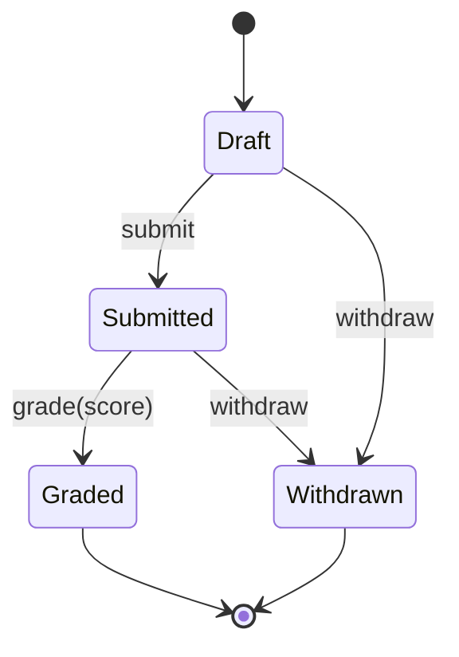
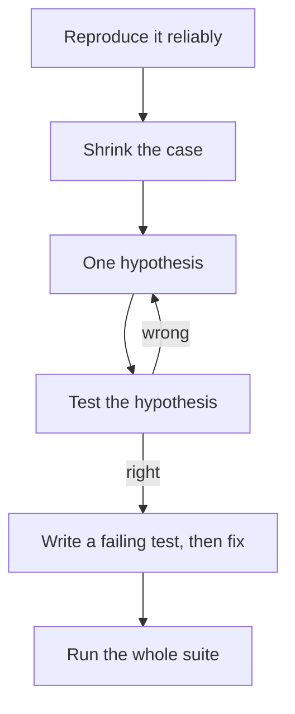

## Learning goals
{: #learning-goals }

By the end of this chapter, you should be able to:

- Say what a test suite buys you, and what it can never prove.
- Write a test that fails for one reason and says why in its name.
- Choose cases deliberately with equivalence partitions and boundary values instead of picking numbers.
- Model an object's lifecycle as a state machine and test every transition, valid and invalid.
- Use JUnit's `@BeforeEach`, `assertThrows`, `assertAll`, and parameterised tests.
- Tell a syntax error from a logic error from a runtime error, and know which tool finds each.
- Debug by a method: reproduce, isolate, hypothesise, test, fix.
- Turn every bug you fix into a regression test.

**Starting point:** you can write JUnit tests and run them with Maven (), write contracts (), and design small classes ().

## What tests are for
{: #why-tests }

A test suite is not proof that software works. Dijkstra's warning still holds: testing shows the presence of defects, never their absence. What it buys is something more practical.

- **Freedom to change.**  said clean code keeps the next change cheap. Tests are what make a change *safe*: you alter the design and the suite tells you in seconds whether behaviour moved.
- **A specification you can run.** Acceptance criteria from  stop being a document that drifts and become a check that fails when the code and the document disagree.
- **Faster debugging.** A failing test names the behaviour that broke. A bug report says "it does not work".
- **Pressure towards better design.** Code that is hard to test is usually code with too many responsibilities (). The difficulty is information.

Tests come in sizes. **Unit tests** check one class or method in isolation: milliseconds each, hundreds of them, and the subject of this chapter. **Integration tests** check that parts work together — a service and a database (). **End-to-end tests** drive the whole system as a user would: slow, brittle, valuable in small numbers. Write many of the first, fewer of the second, and few of the third.

## Anatomy of a good test
{: #good-tests }

A test has three parts, usually in this order: **arrange** the situation, **act** on the thing under test, **assert** what must be true.

```java
@Test
@DisplayName("grading a draft is refused")
void gradingADraftIsRefused() {
    Submission submission = new Submission("Nino");          // arrange

    IllegalStateException refused =                           // act
            assertThrows(IllegalStateException.class, () -> submission.grade(70));

    assertEquals("Cannot grade a submission that is DRAFT", refused.getMessage());   // assert
}
```

Six properties separate a test you will keep from one you will delete in a month:

| Property | What it means in practice |
| --- | --- |
| One behaviour | A test that can fail for three reasons tells you nothing when it fails. |
| Named after the behaviour | `gradingADraftIsRefused`, not `test3`. The name is what you read in the report. |
| Independent | Any test can run alone, in any order. No shared state left behind. |
| Deterministic | Same result every run: no clock, no randomness, no network, no default locale (). |
| Fast | Milliseconds. A suite that takes five minutes is a suite nobody runs. |
| No logic | No loops or conditions in a test. If the test needs thinking, it needs its own tests. |

A test that fails intermittently — a **flaky** test — is worse than no test, because it trains the team to ignore red. Find the shared state, the timing assumption, or the hidden ordering, and fix it or delete the test.

## Equivalence partitions
{: #partitions }

You cannot try every input: `grade(int)` alone has four billion. **Equivalence partitioning** splits the inputs into groups where you expect the program to behave the same way, and takes one value from each group.

For a score between 0 and 100, the groups are:

| Partition | Example | Expected |
| --- | --- | --- |
| Below the range | −5 | refused |
| Valid, failing | 20 | accepted, not a pass |
| Valid, passing | 70 | accepted, a pass |
| Above the range | 150 | refused |

Four tests instead of four billion, chosen because each one represents a different *reason* the program might behave differently. Partitions exist for outputs and for states too: a submission that is a draft, one that is handed in, one that is graded.

## Boundary values
{: #boundaries }

Partitions tell you where the groups are; bugs live at their edges. **Boundary value analysis** tests the value just below a boundary, the boundary itself, and the value just above it.

Every boundary has three interesting values, and  showed why: `>=` written as `>` changes the answer at exactly one of them.

| Boundary | Test | Why |
| --- | --- | --- |
| Lowest valid score | −1, 0, 1 | catches `> 0` written for `>= 0` |
| Highest valid score | 99, 100, 101 | catches `< 100` written for `<= 100` |
| Pass mark | 49, 50, 51 | the rule from week 1 |
| Empty collection | 0 items, 1 item | loops that never run, or run once |

In the worked example below, the twelve tests include scores of 0, 50, 100, −1, and 101 for exactly this reason. When someone later writes `score >= 100` instead of `score > 100`, one test fails and names the value.

## Combinations
{: #decision-tables }

When behaviour depends on several conditions, a **decision table** keeps you honest. List the conditions, enumerate the combinations that matter, and write down the expected result.

| Handed in? | Score valid? | Already graded? | Expected |
| --- | --- | --- | --- |
| no | — | — | refuse: not submitted |
| yes | no | no | refuse: bad score |
| yes | yes | no | accept, state becomes graded |
| yes | yes | yes | refuse: already graded |

Three booleans have eight combinations, but only four are reachable and meaningful; the table is where you discover that. If a table has twenty rows, that is a message about the design, not about testing — the method is probably doing too much ().

## State machines
{: #state-machines }

Many objects are not a calculation but a **lifecycle**: an order, a booking, a submission. Their rules are about *when* something is allowed, so the clearest model is a **state machine**: states, events, and the transitions between them.

Mermaid renders UML state machine notation directly, so the model can live beside the code:



The diagram is also a test plan. Draw the transition table — states down the side, events across the top — and every cell is a test: the arrows are the transitions that must work, and the empty cells are the ones that must be refused.

| State | submit | grade | withdraw |
| --- | --- | --- | --- |
| Draft | → Submitted | refuse | → Withdrawn |
| Submitted | refuse | → Graded | → Withdrawn |
| Graded | refuse | refuse | refuse |
| Withdrawn | refuse | refuse | refuse |

Twelve cells, twelve behaviours. Student projects test the three arrows and forget the nine refusals, and that is precisely where the bugs are: an assignment graded twice, a withdrawal after the result was published.

## A tested state machine
{: #worked-example }

The example is a Maven project, [examples/week-07/submission]({{ '/examples/week-07/submission/pom.xml' | relative_url }}), built like the one in . The class under test is a submission that refuses anything its state does not allow — download [Submission.java]({{ '/examples/week-07/submission/src/main/java/Submission.java' | relative_url }}):





Two exception types appear, and the difference matters. `IllegalStateException` means *the object is not in a state where this makes sense*; `IllegalArgumentException` means *the value you passed is wrong*. A caller can act on that distinction, and so can a test.

A short program walks the states — download [SubmissionDemo.java]({{ '/examples/week-07/submission/src/main/java/SubmissionDemo.java' | relative_url }}):

```shell
mvn -q compile
java -cp target/classes SubmissionDemo
```

```text
Nino: DRAFT
Nino: SUBMITTED
Nino: GRADED with 87
Luka: WITHDRAWN
Refused: Cannot grade a submission that is DRAFT
Refused: Score must be between 0 and 100: 101
```

The tests cover the transition table and the score boundaries — download [SubmissionTest.java]({{ '/examples/week-07/submission/src/test/java/SubmissionTest.java' | relative_url }}):





```shell
mvn test
```

```text
[INFO] Running SubmissionTest
[INFO] Tests run: 12, Failures: 0, Errors: 0, Skipped: 0, Time elapsed: 0.110 s -- in SubmissionTest
[INFO] BUILD SUCCESS
```

Twelve tests from nine test methods: the parameterised ones count once per value.

## JUnit features for this week
{: #junit-features }

Four additions to the `@Test` and `assertEquals` from .

**`@BeforeEach`** runs before every test, which is how each test gets a fresh object and stays independent:

```java
private Submission submission;

@BeforeEach
void createDraft() {
    submission = new Submission("Nino");
}
```

**`assertThrows`** checks that something is refused, and hands you the exception so you can check the message:

```java
IllegalStateException refused =
        assertThrows(IllegalStateException.class, () -> submission.grade(70));
assertEquals("Cannot grade a submission that is DRAFT", refused.getMessage());
```

A test without `assertThrows` cannot check a refusal at all: the exception would simply fail the test with a stack trace instead of a clear message.

**`assertAll`** runs several assertions and reports every failure, instead of stopping at the first:

```java
assertAll(
        () -> assertEquals(SubmissionState.GRADED, submission.state()),
        () -> assertEquals(87, submission.score()));
```

**`@ParameterizedTest`** runs the same test for several values — the natural way to write a partition or a boundary set:

```java
@ParameterizedTest(name = "a score of {0} is refused")
@ValueSource(ints = {-1, 101})
void refusesScoresOutOfRange(int score) {
    submission.submit();
    assertThrows(IllegalArgumentException.class, () -> submission.grade(score));
}
```

`@CsvSource({"49, false", "50, true"})` does the same for pairs, which suits expected-results tables.

## Test doubles
{: #test-doubles }

A unit test should fail because the unit is wrong, not because a database was down. A **test double** stands in for a collaborator:

| Double | What it does | Use it when |
| --- | --- | --- |
| Stub | returns fixed answers | the unit needs data from somewhere |
| Fake | a real but simple implementation, such as an in-memory store | the collaborator is slow or external |
| Mock | records calls so the test can assert on them | the interaction itself is the behaviour |

This is where the interfaces from  pay for themselves: because the code depends on `GradeFormat` rather than on `CsvFormat`, a test can pass in a five-line fake. If a class cannot be tested without its real collaborators, that is a design message — usually a missing interface or a dependency created inside the class instead of handed to it.

Keep doubles few. Tests full of mocks check that the code calls what you expected, which is a test of your assumptions rather than of behaviour.

## Coverage, and what it does not tell you
{: #coverage }

**Coverage** measures how much of the code the tests executed: line coverage counts lines, branch coverage counts the ways through each decision. Branch coverage is the more honest number, because a single test can touch every line of an `if` without ever taking the `else`.

Coverage finds code nobody tests. It cannot find:

- Cases you never thought of. A hundred per cent coverage with no test at the boundary still ships the `>=` bug.
- Missing assertions. A test that calls a method and asserts nothing covers it perfectly.
- Wrong expectations. A test asserting the wrong answer is green and useless.

Treat it like the metrics in : a smoke alarm, not a grade. "Which important class has 20 per cent?" is a good question; "we must reach 90 per cent" produces tests written to raise a number. Measuring it automatically comes in .

## Kinds of error
{: #error-types }

Knowing which kind you have tells you which tool to reach for.

| Kind | When it appears | Example | Found by |
| --- | --- | --- | --- |
| Syntax error | compiling | a missing brace or semicolon | the compiler, immediately |
| Type error | compiling | passing a `String` where an `int` is needed | the compiler |
| Runtime error | running | `NullPointerException`, division by zero, a refused precondition | a crash, a stack trace, a test |
| Logic error | never, by itself | `>` where `>=` was meant | only a test or a user |

Logic errors are the dangerous ones precisely because nothing announces them, which is why  insisted on deciding expected results from the rule.

A stack trace is a reading exercise, not a wall of text. Read the first line for the exception type and message, then the first frame that names *your* class: that is where to look. Frames below it are the library; frames above are the path that got you there. `Caused by:` at the bottom is usually the real failure.

## Debugging as a method
{: #debugging }

Debugging by changing things until the symptom disappears produces code nobody understands. The method is a loop, and it is the same scientific loop as everywhere else.



**Reproduce it.** A bug you cannot reproduce cannot be fixed, only hidden. Find the exact input, state, and steps. If it happens once in twenty runs, that is information: something is ordering- or timing-dependent.

**Shrink the case.** Remove everything that still leaves the bug. A failing unit test with two lines of setup beats clicking through five screens, and shrinking often reveals the cause before you look at any code.

**One hypothesis at a time.** Write it as a sentence that can be false: "the score is stored before the state is checked". Then test *that*, by one assertion, one print, or one breakpoint. Changing three things at once means that if the symptom disappears you have learned nothing.

**Bisect.** When it worked last week and fails today, the history knows: `git bisect start`, mark one good and one bad commit, and Git walks you through the halves until one commit is guilty (). Twenty commits take about five checks.

**Use the debugger for state, prints for flow.** A breakpoint with a watch on a variable answers "what is it right now?" far better than a print. A few well-placed prints answer "which path did it take?" better than stepping. Both are legitimate; remove the prints before committing, and logging () is their grown-up form.

**Rubber duck.** Explaining the problem out loud, to a person or an object, forces the assumptions into words. Half of all bugs are found mid-sentence.

## Regression tests
{: #regression }

A **regression** is a bug that comes back, or a change that breaks something that worked. The habit that prevents it is short:

1. Reproduce the bug **as a failing test**, named after the behaviour: `withdrawingAfterGradingIsRefused`.
2. Watch it fail, for the right reason. A test that passes before the fix is testing the wrong thing.
3. Fix the code.
4. Watch it pass, and run the whole suite.
5. Commit the test and the fix together (), with the issue number in the message.

Now suppose someone later weakens the upper bound in `grade`, writing `score >= 100` where `score > 100` was meant. One run says exactly what happened:

```text
[ERROR] Errors:
[ERROR]   SubmissionTest.acceptsScoresInRange:79 » IllegalArgument Score must be between 0 and 100: 100
[ERROR] Tests run: 12, Failures: 0, Errors: 1, Skipped: 0
[INFO] BUILD FAILURE
```

One of twelve tests, the parameterised case for the value 100, with the file and line. That is the whole argument for boundary tests in six lines of output — and in , a server runs this on every pull request so the author sees it before a reviewer does.

## Check your understanding
{: #check-understanding }

<details markdown="1">
<summary>Your suite is green. What have you proved?</summary>

That the behaviours you thought of, as you tested them, are correct today. Nothing about the cases you never wrote, and nothing about behaviour you asserted incorrectly. Green means "no known defects", which is worth a great deal and is not the same as "no defects".

</details>

<details markdown="1">
<summary>Why test 49, 50, and 51 rather than 10, 50, and 90?</summary>

Because a plausible mistake — `>` instead of `>=` — changes the answer only at the boundary. The values 10 and 90 pass under both the right rule and the wrong one, so they cost a test each and prove almost nothing.

</details>

<details markdown="1">
<summary>A state machine has four states and three events. How many behaviours are there to check?</summary>

Twelve: every state-event pair either does something or is refused, and both are behaviour. Most projects test only the arrows in the diagram, which is three or four of the twelve, and the bugs live in the nine refusals.

</details>

<details markdown="1">
<summary>When should a test use `IllegalStateException` rather than `IllegalArgumentException`?</summary>

The test follows the code's contract: the argument type is for a value that is wrong in itself, such as a score of 101, and the state type is for a call that makes no sense right now, such as grading a draft. Asserting the right type is part of asserting the right behaviour.

</details>

<details markdown="1">
<summary>A bug appears once in twenty runs. What does that tell you before you look at any code?</summary>

That something varies between runs: ordering, timing, a shared field between tests, a default locale or time zone, a random value, or state left behind by another test. The variation is the lead — find what differs rather than reading the logic again.

</details>

<details markdown="1">
<summary>You fixed a bug in five minutes without writing a test. What have you lost?</summary>

The guarantee that it stays fixed, and the record of what was wrong. The test is what stops the same mistake returning in six months, and its name documents the case better than a commit message can.

</details>

## Your turn
{: #your-turn }

### Design the cases before writing them

Take `RetakeEligibility` from , or any method of your own with at least two conditions.

1. Write the equivalence partitions for each parameter.
2. Add the boundary values: just below, at, just above.
3. Build a decision table for the combinations that are reachable.
4. Turn the table into JUnit tests, using `@ParameterizedTest` with `@CsvSource` for the rows.
5. Count: how many of your tests would still pass if someone changed one comparison from `>=` to `>`?

<details markdown="1">
<summary>What the count tells you</summary>

If most of your tests survive that change, they are not pulling their weight — they all sit in the middle of a partition. A good suite has at least one test that fails for every plausible single-character mistake in the rules you care about.

The exercise is also an argument for writing cases before code: it is much easier to think "what are the groups and edges?" with the rule in front of you than to reverse-engineer them from an implementation you have just written.

</details>

### Test a lifecycle completely

1. Draw the state machine for something in your project — an order, a booking, a request — with at least three states.
2. Write the transition table: states down, events across, every cell filled with a transition or a refusal.
3. Implement it as a class that refuses what the table refuses.
4. Write one test per cell. Use `@BeforeEach` for the fresh object, and `assertThrows` for the refusals.
5. Delete one guard clause in the implementation and check that exactly one test fails.

<details markdown="1">
<summary>What step 5 proves</summary>

That each refusal has a test of its own. If deleting a guard turns three tests red, they overlap; if it turns none red, that refusal is untested, which is where the next bug will be.

It is also the quickest review of a test suite you did not write: break something on purpose and see whether the suite notices.

</details>

### Debug with the method, not by guessing

Take the example project and introduce a bug for a classmate — or ask them to introduce one for you. Change `score > 100` to `score >= 100`, or let `withdraw` work after grading.

1. Run `mvn test` and read only the failure summary. Which test, which line, which values?
2. Write down one hypothesis as a sentence that could be false.
3. Test the hypothesis with a single breakpoint or a single print.
4. Fix it, run the suite, and check that nothing else moved.
5. Commit the fix with the test, and write a message that says what was wrong ().

<details markdown="1">
<summary>What a good failure report looks like</summary>

```text
[ERROR] Errors:
[ERROR]   SubmissionTest.acceptsScoresInRange:79 » IllegalArgument Score must be between 0 and 100: 100
[ERROR] Tests run: 12, Failures: 0, Errors: 1, Skipped: 0
```

The test name says which behaviour broke, the line says where to look, and the message carries the value that caused it. Compare that with "the grading page is broken", which is what you get without tests — and notice that you never had to open a debugger.

</details>

## Summary and key terms
{: #summary }

- Tests buy freedom to change, a runnable specification, and faster debugging; they never prove the absence of defects.
- A good test checks one behaviour, is named after it, runs in milliseconds, and gives the same answer every time.
- Choose cases with equivalence partitions, then add the boundary values where single-character mistakes change the answer.
- A decision table covers reachable combinations; a long table is a message about the design.
- A lifecycle is a state machine, and its transition table is a test plan — including the refusals, which is where the bugs are.
- JUnit gives you `@BeforeEach` for independence, `assertThrows` for refusals, `assertAll` for several facts, and parameterised tests for partitions.
- Test doubles replace awkward collaborators; needing many of them is a design signal.
- Coverage shows untested code and proves nothing about untested cases.
- Debug by method: reproduce, shrink, one hypothesis, test it, fix with a failing test first, run everything.
- Every fixed bug leaves a regression test behind.

| English | ქართული |
| --- | --- |
| Testing | ტესტირება |
| Unit test | ერთეულოვანი ტესტი |
| Test-driven development (TDD) | ტესტზე დაფუძნებული განვითარება |
| Equivalence partition | ეკვივალენტობის კლასი |
| Boundary value | სასაზღვრო მნიშვნელობა |
| State machine | მდგომარეობათა მანქანა |
| Syntax error | სინტაქსური შეცდომა |
| Logic error | ლოგიკური შეცდომა |
| Runtime error (exception) | Runtime შეცდომა (გამონაკლისი სიტუაცია) |
| Debugging | პროგრამის გამართვა (debugging) |
| Regression test | რეგრესიული ტესტი |
| Test coverage | ტესტებით დაფარვა |

## Further reading
{: #further-reading }

- [JUnit 5 User Guide](https://junit.org/junit5/docs/current/user-guide/) — annotations, assertions, parameterised tests, and test lifecycle.
- Andreas Zeller, *Why Programs Fail*, second edition — systematic debugging, from reproducing to isolating causes; the source of most of the method above.
- Glenford Myers, *The Art of Software Testing* — partitions, boundary values, and decision tables, where these techniques were first written down.
- Martin Fowler, [Test Double](https://martinfowler.com/bliki/TestDouble.html) and [Eradicating Non-Determinism in Tests](https://martinfowler.com/articles/nonDeterminism.html) — doubles, and what to do about flaky tests.
- [git bisect documentation](https://git-scm.com/docs/git-bisect) — finding the commit that introduced a bug, in about five checks.
- Pankaj Jalote, [A Concise Introduction to Software Engineering](https://link.springer.com/book/10.1007/978-3-031-74318-4), chapter 7 — testing concepts, black-box and white-box techniques.
